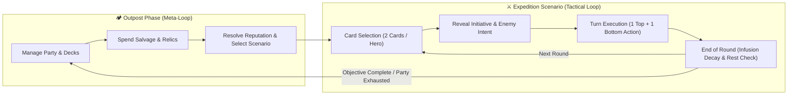

# Product Requirements Document (PRD): The Fabled Expedition

## 1. Blueprint Review & Design Audit

> [!IMPORTANT]
> **Critical Design Fixes Applied to Source Blueprint**
> Reviewing the initial concept revealed four structural contradictions and design gaps that would block implementation or dilute the *Frosthaven*-inspired tactical identity. This PRD resolves them as follows:

| Blueprint Area | Issue Identified | PRD Resolution |
| :--- | :--- | :--- |
| **Initiative & RNG** | Blueprint specified *"Initiative determined by character stats and dice rolls"*. *Frosthaven*'s core tension comes from deterministic card-driven initiative and deck-based attack modifiers, not dice rolls. | Replaced dice initiative with **Lead Card Initiative (01–99)** chosen secretly during the Card Selection phase, and replaced raw damage RNG with a **20-Card Attack Modifier Deck** (`+0`, `+1`, `-1`, `2x`, `Null`). |
| **Action Economy Contradiction** | Blueprint contradicted itself: *"shared Action Pool per turn"* vs *"Energy (shared resource pool per party member)"* vs *"hand size set by party composition"*. | Standardized on the **Dual-Action Card System** (select 2 cards per round; execute **Top Action** of one + **Bottom Action** of the other) paired with **Hand/Discard/Lost Stamina Pacing** and a **Party Resonance / Infusion Board** for cross-class synergy. |
| **Scenario vs. Class Decks** | Section 3C stated *"Ability Deck: Specific to the Scenario"*, conflicting with Section 3A (class-based ability decks). | Separated card systems into: **1) Class Ability Decks** (owned by characters), **2) Enemy AI Intent Decks** (per monster archetype), and **3) Scenario Lore/Hazard Cards** (triggered by hex POIs and room breaches). |
| **Missing MVP Technical Spec** | Blueprint lacked data models, turn state machine, UI layout, and asset strategy—causing implementation agents to stall or output text instead of playable code. | Added concrete **State Machine**, **Entity Schemas**, **UI Layout Requirements**, and **Zero-Asset Procedural/SVG Visual Spec** so the game can be built and played immediately in-browser. |

---

## 2. Executive Summary & Product Vision

- **Title:** *The Fabled Expedition: Chronicles of the Lost*
- **Genre:** Turn-Based Tactical Hex RPG / Deck-Driven Dungeon Crawler
- **Setting & Tone:** Low-Fantasy Dieselpunk / Forgotten Civilization. Expeditions descend into sunken, clockwork-and-vine-choked ruins where brass machinery meets ancient arcane resonance. High tactical tension, moral ambiguity, zero filler combat.
- **Target Platform:** Web-first playable build (HTML5 / TypeScript / Canvas or SVG with React UI overlay), 16:9 desktop viewport (`1280x720` minimum).
- **Core Value Proposition:** Captures *Frosthaven*'s signature two-card tactical puzzle, deterministic enemy telegraphing, card-burn stamina timer, and outpost progression in a streamlined, 20-minute-per-scenario indie package.

---

## 3. Core Gameplay Loops



### 3.1 Tactical Round State Machine
Every round inside a scenario strictly follows five sequential phases:

1. **`PHASE_PLANNING` (Card Selection & Rest Declaration)**
   - For each living party member, the player either selects **2 Ability Cards** from their hand (designating the first as the **Initiative Lead Card**) OR declares a **Long Rest** (requires $\ge 2$ cards in Discard; sets Initiative to `99`).
   - Players may also declare a **Short Rest** at the end of the previous round (random 1 card Lost from Discard, return rest to Hand).
2. **`PHASE_REVEAL` (Initiative & Enemy Intent)**
   - All hero Lead Card initiatives (`01`–`99`) are revealed.
   - Each active Enemy Group draws/reveals 1 **AI Intent Card** showing its round Initiative, Movement, Attack, Range, and Special Modifiers.
   - Turn Order Queue is sorted ascending by Initiative (ties broken in favor of heroes).
3. **`PHASE_TURN_EXECUTION` (Active Unit Turn)**
   - **Hero Turn:** Player chooses one of their 2 selected cards for its **Top Action** and the other for its **Bottom Action** (executed in either order).
     - Any card's Top Action can be forfeited for a **Basic Attack 2 (Melee)**.
     - Any card's Bottom Action can be forfeited for a **Basic Move 2**.
     - Used cards move to the **Discard Pile**, or to the **Lost (Burned) Pile** if the executed half has the `🔥 Burn` icon.
   - **Enemy Turn:** Each figure in the active Enemy Group automatically executes its revealed AI Intent Card using deterministic focus rules (focus on enemy reachable with minimum movement; tie-breaker: fastest initiative, then closest hex).
4. **`PHASE_POI_INTERACTION` (Hex Triggers & Lore Checks)**
   - Stepping onto or ending a turn on a Point of Interest (POI) hex triggers traps, loot collection, door breaching (revealing adjacent room hexes and spawning its enemies), or **Lore Choice Modals**.
5. **`PHASE_ROUND_END` (Cleanup & Resonance Decay)**
   - Elemental/Diesel Infusions shift one step down: `Strong` $\rightarrow$ `Waning` $\rightarrow$ `Inert`.
   - Status effects with round durations (`Wound`, `Immobilize`, `Stun`, `Overcharge`, `Shield`) tick or clear.
   - Victory/Defeat conditions are evaluated.

---

## 4. Core Systems & Mechanics Specification

### 4.1 Hexagonal Grid & Spatial Rules
- **Coordinate System:** Axial coordinates `(q, r)` with cube coordinate conversion `(q, r, s = -q - r)` for distance and line-of-sight calculations.
- **Hex Terrain Types:**

| Terrain Type | Visual Cue | Mechanical Effect |
| :--- | :--- | :--- |
| **Clear Floor / Stone** | Slate stone / rusted grating | Standard movement (`1 Move point`). |
| **Difficult Terrain (Mire / Rubble)** | Flooded water / tangled pipes | Costs `2 Move points` to enter (unless unit has `Jump` or `Hover`). |
| **Hazardous Terrain (Scalding Steam / Acid)** | Glowing amber vents / green sludge | Costs `1 Move point`; inflicts `2 True Damage` upon entry. |
| **Obstacle (Pillar / Ruined Turbine)** | High-contrast solid silhouette | Blocks movement, cannot be entered without `Hover`; does not block Line of Sight. |
| **Wall / Sealed Bulkhead** | Heavy dark border / brass door | Blocks movement and Line of Sight. Doors open when a hero steps on them, immediately revealing the next room. |
| **Trap / Mine** | Red hazard glyph | Triggers on entry (`3 Damage` + status effect) unless disarmed by a Utility action. |
| **Lore Node / Relic Chest** | Cyan/Gold pulsing beacon | Interacting triggers a Narrative Choice or grants Salvage/Relic rewards. |

- **Tactical Positioning Bonuses:**
  - **Flanking:** Attacking an enemy while an allied hero is adjacent to that same enemy on the opposite hex hemisphere grants **Advantage** on the Attack Modifier draw (draw 2 modifier cards, take the better one).
  - **Cover:** Ranged attacks targeting a unit adjacent to an Obstacle along the Line of Sight suffer **Disadvantage** (draw 2 modifier cards, take the worse one).

### 4.2 Card, Stamina & Exhaustion System
- **Hand Limit:** Fixed per class (`8` to `11` cards).
- **Card Anatomy:**
  - `Title` & `Level (1–3)`
  - `Initiative Value (01–99)` (center badge)
  - `Top Action Box`: Attack, Targeted Buff/Debuff, AoE Hex Pattern, Infusion Generation/Consumption, optional `🔥 Burn` icon (`+XP`).
  - `Bottom Action Box`: Move, Jump, Shield, Heal, Trap/Summon, Infusion Generation/Consumption, optional `🔥 Burn` icon (`+XP`).
- **Rest & Exhaustion (The Built-In Clock):**
  - **Short Rest (End of Round):** Shuffle Discard pile, randomly move 1 card to the **Lost Pile**, return remaining cards to Hand. Player may take `1 Damage` to redraw the random Lost card once.
  - **Long Rest (Full Round Action at Initiative 99):** Player chooses which 1 card from Discard moves to the **Lost Pile**, returns remaining Discard to Hand, heals `2 HP`, and refreshes spent Relic items.
  - **Exhaustion:** If a hero reaches `0 HP` OR cannot play 2 cards (and has fewer than 2 cards in Discard to rest) at the start of a round, they become **Exhausted** and are removed from the map for the remainder of the scenario. If all heroes exhaust, the expedition fails.
- **Damage Mitigation via Card Burn:** A hero may negate any single incoming source of damage by moving `1 card from Hand` or `2 cards from Discard` to the **Lost Pile**.

### 4.3 Resonance Infusions (Party Synergy Engine)
Replaces generic mana pools with a shared **4-Element Dieselpunk Resonance Board** that rewards party combo chains:
1. **💨 Steam (Pressure):** Generated by Vanguard/Sentinel; consumed for knockback, armor plating, or extra movement.
2. **⚡ Volt (Arc):** Generated by Scavenger/Sentinel; consumed for chain damage, stun, or turret overcharge.
3. **🔮 Aether (Void):** Generated by Lorekeeper; consumed for true damage, teleportation, or deck manipulation.
4. **🌿 Mire (Toxin):** Generated by Scavenger/Lorekeeper; consumed for poison, immobilize, or healing Spores.

*Rule:* Infusing an element sets it to **Strong** at the end of the active unit's turn. On subsequent turns (by teammates in the same round, or anyone in the next round while **Waning**), another ability can **Consume** that element to trigger a powerful bonus effect.

### 4.4 Attack Modifier Deck & Status Conditions
- **Attack Modifier Deck (20 Cards per Party / Enemy Group):**
  - `6x` `[+0]`, `5x` `[+1]`, `5x` `[-1]`, `1x` `[+2]`, `1x` `[-2]`, `1x` `[2x Critical (Shuffle)]`, `1x` `[0x Null/Miss (Shuffle)]`.
- **Core Status Conditions:**
  - **Poison:** All attacks targeting this unit gain `+1 Attack`. Removed when healed.
  - **Wound:** Unit suffers `1 True Damage` at the start of its turn. Removed when healed.
  - **Immobilize:** Unit cannot perform Move actions until the end of its next turn.
  - **Stun:** Unit cannot perform any actions on its next turn (still plays 2 cards to discard).
  - **Muddle:** Unit attacks with **Disadvantage** until the end of its next turn.
  - **Strengthen:** Unit attacks with **Advantage** until the end of its next turn.
  - **Shield $X$:** Reduces incoming attack damage by $X$ for the round.
  - **Pierce $X$:** Ignores up to $X$ points of target's Shield.

---

## 5. Content Specification (MVP Scope)

### 5.1 Playable Character Classes (The Party)
For the playable game, the player controls a party of **3 or 4 Heroes** on the map simultaneously (or selects 3 from the 4 archetypes for each expedition):

#### 1. The Vanguard (*Ironclad Breacher*)
- **Role:** Frontline Tank / Crowd Control / Positional Bruiser
- **Base Stats (Lv 1):** `10 HP` | `Hand Size: 10`
- **Primary Infusions:** Generates **💨 Steam**, Consumes **💨 Steam** & **⚡ Volt**
- **Starter Signature Cards (6 core cards for MVP):**
  1. *Piston Charge* (Init `18`): **Top:** Attack 3, Push 1 (Infuse 💨 Steam). **Bottom:** Move 3, Jump.
  2. *Bulkhead Stance* (Init `12`): **Top:** Shield 2 self and adjacent allies this round. **Bottom:** Move 2, Pull 1 adjacent enemy within Range 2.
  3. *Concussive Vent* (Init `45`): **Top:** Attack 2 (3-hex cone), Muddle (Consume 💨 Steam: +1 Attack, Immobilize). **Bottom:** Move 2, Heal 2 self.
  4. *Hydraulic Slam* (Init `72`): **Top:** Attack 5, Wound, `+2 XP` (`🔥 Burn`). **Bottom:** Move 4.
  5. *Trench Anchor* (Init `29`): **Top:** Attack 3 (Pierce 2 if adjacent to ally). **Bottom:** Shield 1, Retaliate 1 this round.
  6. *Overpressure Sweep* (Init `61`): **Top:** Attack 2 all adjacent enemies. **Bottom:** Move 3 (Consume ⚡ Volt: Strengthen self).

#### 2. The Scavenger (*Rust-Stalker*)
- **Role:** High-Mobility Striker / Trap Specialist / Flanker
- **Base Stats (Lv 1):** `8 HP` | `Hand Size: 9`
- **Primary Infusions:** Generates **⚡ Volt** & **🌿 Mire**, Consumes **💨 Steam** & **🌿 Mire**
- **Starter Signature Cards (6 core cards for MVP):**
  1. *Arc Shiv* (Init `09`): **Top:** Attack 3 (+2 Attack if target is flanked by an ally; Infuse ⚡ Volt). **Bottom:** Move 4.
  2. *Scrap Caltrops* (Init `34`): **Top:** Place a `3 Damage + Immobilize` trap in adjacent empty hex; Loot 1 adjacent hex. **Bottom:** Move 3, Disarm 1 adjacent trap.
  3. *VenomousInjector* (Init `21`): **Top:** Attack 2, Range 3, Poison (Consume 🌿 Mire: also Wound). **Bottom:** Move 3, Jump.
  4. *Smoke Canister* (Init `14`): **Top:** Attack 2; Enemies treat your hex as Cover this round. **Bottom:** Move 2, grant adjacent ally Move 2.
  5. *Dredge the Passage* (Init `25`): **Top:** Disarm trap or open door at Range 2; grant allies +1 Move this round. **Bottom:** Move 5 (`🔥 Burn`).
  6. *Execution Wire* (Init `81`): **Top:** Attack 6 against Poisoned or Wounded target, `+2 XP` (`🔥 Burn`). **Bottom:** Move 2, Infuse 🌿 Mire.

#### 3. The Lorekeeper (*Aether Scholar*)
- **Role:** Ranged Controller / Deck Manipulator / Narrative Specialist
- **Base Stats (Lv 1):** `6 HP` | `Hand Size: 11`
- **Primary Infusions:** Generates **🔮 Aether**, Consumes **🔮 Aether** & **🌿 Mire**
- **Starter Signature Cards (6 core cards for MVP):**
  1. *Resonant Bolt* (Init `38`): **Top:** Attack 2, Range 4 (Infuse 🔮 Aether). **Bottom:** Move 2, Heal 2 Range 3.
  2. *Chronicle of Decline* (Init `52`): **Top:** Target 2 enemies within Range 3: Curse / Muddle (Consume 🔮 Aether: also Stun 1 target). **Bottom:** Move 3.
  3. *Memory Recall* (Init `88`): **Top:** Target ally within Range 3 recovers up to 2 Discarded cards to Hand. **Bottom:** Move 2, Shield 1 allies within Range 2.
  4. *Singularity Collapse* (Init `67`): **Top:** Attack 4, Range 3, 3-hex triangle AoE, Pull 1 toward center (`🔥 Burn`, Infuse 🔮 Aether). **Bottom:** Teleport 4 (ignores terrain/figures).
  5. *Siphon Vitality* (Init `41`): **Top:** Attack 2, Range 3; Heal 2 self or ally adjacent to target (Consume 🌿 Mire: Poison all enemies adjacent to target). **Bottom:** Move 2.
  6. *Ancient Inscription* (Init `19`): **Top:** Grant target ally `+2 Attack` on their next attack this round. **Bottom:** Move 3, automatically succeed on adjacent Lore Node check.

#### 4. The Sentinel (*Automaton Warden*)
- **Role:** Mid-Range Support / Turret & Zone Controller / Secondary Frontliner
- **Base Stats (Lv 1):** `9 HP` | `Hand Size: 9`
- **Primary Infusions:** Generates **⚡ Volt** & **💨 Steam**, Consumes **⚡ Volt** & **🔮 Aether**
- **Starter Signature Cards (6 core cards for MVP):**
  1. *Deploy Coil Turret* (Init `31`): **Top:** Summon/Place Coil Turret in adjacent hex (`4 HP`, attacks closest enemy Range 2 for `Attack 2` at start of Sentinel's turn; `🔥 Burn`). **Bottom:** Move 3.
  2. *Voltaic Lance* (Init `27`): **Top:** Attack 3, Range 2, Pierce 1 (Infuse ⚡ Volt). **Bottom:** Move 2, Heal 2 adjacent ally.
  3. *Aegis Field* (Init `15`): **Top:** Heal 3 Range 2, remove Poison/Wound (Consume 🔮 Aether: also grant Strengthen). **Bottom:** Move 2, Shield 1 self and adjacent allies.
  4. *Arc Discharge* (Init `49`): **Top:** Attack 2, Range 3, targets 2 enemies (Consume ⚡ Volt: +1 Attack, Immobilize). **Bottom:** Move 3, Infuse 💨 Steam.
  5. *Magnetic Tow* (Init `22`): **Top:** Attack 2, Range 3, Pull 2. **Bottom:** Move 2; swap positions with an ally within Range 3.
  6. *Overclock Protocol* (Init `64`): **Top:** All allies within Range 2 perform `Attack 2` immediately (`🔥 Burn`). **Bottom:** Move 4.

---

### 5.2 Enemy Archetypes & AI Intent Decks
Each enemy type has a 4-card AI Intent Deck shuffled per scenario:
1. **Drowned Construct (Melee Bruiser):** High HP (`7 HP`), `Shield 1`, slow movement. Cards include *Rusted Cleave* (Move 1, Attack 3), *Pressure Vent* (Attack 2 all adjacent, Push 1), *Self-Repair* (Heal 2, Shield 2), *Heavy Charge* (Move 3, Attack 2, Wound).
2. **Silt Lurker (Skirmisher):** Medium HP (`5 HP`), fast initiative (`15`–`35`). Cards include *Darting Bite* (Move 3, Attack 2, Poison), *Submerge* (Move 2, Jump, Muddle adjacent), *Ambush Lunge* (Move 4, Attack 3).
3. **Aether Wisp (Ranged Artillery):** Low HP (`3 HP`), `Shield 2`, `Hover`. Cards include *Void Ray* (Move 1, Attack 2 Range 4, Pierce 1), *Phase Distortion* (Attack 1 Range 3 Target 2, Muddle), *Aether Surge* (Heal 2 allies Range 3, Infuse 🔮 Aether).
4. **The Dredge Overseer (Boss):** High HP (`22 HP`), `Shield 1`, Immune to Stun/Immobilize. Alternates between *Harpoon Reel* (Pull 3 all heroes in LoS, Attack 3), *Scalding Flood* (Turns 3 floor hexes into Hazardous Terrain, Attack 2 Range 3), and *Summon Construct* (Spawns 1 Drowned Construct).

---

### 5.3 Campaign Scenarios (3-Scenario Arc)

#### Scenario 1: *The Sunken Lock of Aethel* (Introductory Breach)
- **Layout:** 2 Rooms (11x8 Hex Grid).
  - *Room 1 (Flooded Sluiceway):* Difficult water terrain, 2 Silt Lurkers, 1 Drowned Construct, 1 Lore Node (*Sluice Valve*).
  - *Room 2 (The Inner Turbine):* Sealed behind a Bulkhead Door; contains 2 Drowned Constructs, 1 Aether Wisp, and the *Aethel Conduit Relic Chest*.
- **Objective:** Open the Bulkhead Door, defeat all guardians, and claim the *Aethel Conduit*.
- **Lore Choice Node (*Sluice Valve*):**
  - *Option A (Drain the Sluice):* Removes all Difficult Terrain in Room 1, but alerts Room 2 (`+1 Drowned Construct` spawns when door opens; `+1 Reputation`).
  - *Option B (Siphon the Pressure):* Infuses **💨 Steam** and **⚡ Volt** to Strong immediately and grants `15 Salvage`, but deals `2 Damage` to the interacting hero (`-1 Reputation`).

#### Scenario 2: *The Whispering Foundry* (Escort & Hazard Control)
- **Layout:** 2 Rooms with active Hazardous Steam Vents and Scrap Traps.
- **Objective:** Destroy 2 **Corrupted Resonators** (Objective Obstacles with `10 HP` each) within `10 Rounds` before the foundry collapses.
- **Enemies:** 2 Silt Lurkers, 2 Aether Wisps, 2 Drowned Constructs.
- **Lore Choice Node (*Trapped Automaton Core*):** Free the consciousness (`+2 Reputation`, unlocks *Overclocked Capacitor* Relic) or Harvest for parts (`+30 Salvage`, `-1 Reputation`).

#### Scenario 3: *Sanctum of the Dredge Overseer* (Climax Boss Fight)
- **Layout:** Large hexagonal arena with 4 pillars, 2 Lore Nodes (*Ancient Pylons*), and **The Dredge Overseer** boss + minions.
- **Objective:** Defeat **The Dredge Overseer**. Activating both *Ancient Pylons* strips the Boss's permanent `Shield 1` and infuses **🔮 Aether**.

---

### 5.4 Meta-Progression (Outpost Between Scenarios)
Between scenarios, the party returns to the **Expedition Outpost**:
1. **Salvage (Gold) & Relic Shop:** Spend Salvage looted from hexes to buy/equip Relics:
   - *Stamina Tonic (15 Salvage):* During your turn, recover up to 2 Discarded cards to Hand (Consumed per scenario).
   - *Pneumatic Boots (20 Salvage):* Add `+2 Move` and `Jump` to a single Move action (Spent; refreshes on Long Rest).
   - *Aegis Aether-Plate (25 Salvage):* Negate the next `2 Damage` from an attack (Spent; refreshes on Long Rest).
   - *Resonance Lens (30 Salvage):* Infuse any 1 Element on demand once per scenario.
2. **Reputation Track (`-5` Ruthless Scavengers to `+5` Revered Preservationists):**
   - High Reputation (`+2` or higher) reduces Outpost Relic prices by `20%` and unlocks a bonus **Bless (`2x`)** card in the Party Modifier Deck.
   - Low Reputation (`-2` or lower) grants `+10 Starting Salvage` per scenario and adds `+1 Pierce` to the first attack each hero makes per room.
3. **Character Level-Up & Perks:**
   - Gaining `15 XP` levels up a hero (`+2 Max HP`), unlocks a **Level 2 Card** to swap into their active hand, and grants **1 Perk Point** (e.g., *"Remove two `[-1]` cards from Attack Modifier Deck"* or *"Add two `[+1, Infuse Element]` cards"*).

---

## 6. UI/UX & Visual Architecture

```
+-----------------------------------------------------------------------------------+
| [Round 3]  INITIATIVE TRACK: [09 Scavenger] > [18 Vanguard] > [25 Lurker] > [38]  |
|            RESONANCE BOARD:  [💨 Steam: STRONG] [⚡ Volt: WANING] [🔮: INERT] [🌿] |
+-----------------------------------------------------------------------------------+
|                                                         | ACTIVE UNIT / ENEMY HUD |
|                                                         | - HP / Shield / Status  |
|                                                         | - Enemy Intent Preview  |
|                  HEXAGONAL TACTICAL MAP                 |-------------------------|
|            (Interactive SVG/Canvas Viewport)            | COMBAT LOG & LORE FEED  |
|          - Hover previews move range & AoE hexes        | - Modifier card flips   |
|          - Painterly high-contrast SVG hex tiles        | - Damage & status logs  |
|          - Clear fog-of-war on unrevealed rooms         |                         |
|                                                         |                         |
+-----------------------------------------------------------------------------------+
| HERO HAND & ACTION BAR (Two-Card Selector | Top/Bottom Action Buttons | Rest Btn) |
| [ Card 1 (Init 18) ] [ Card 2 (Init 45) ] [ Card 3 ] [ Card 4 ]  | Discard/Lost   |
+-----------------------------------------------------------------------------------+
```

### Visual Direction (Zero-External-Asset Requirement)
- **Palette:** Deep abyssal slate (`#0d131a`), oxidized bronze (`#c88a4b`), bioluminescent cyan (`#38bdf8`), pressurized amber (`#f59e0b`), and toxic mire green (`#4ade80`).
- **Tile & Unit Rendering:** Custom layered SVG/Canvas artwork with painterly gradients, crisp hex bevels, animated floating status badges, directional attack arcs, and floating damage/modifier popups when the Attack Modifier Deck is drawn.

---

## 7. Data Schemas (Reference Architecture)

```typescript
export type ElementType = 'steam' | 'volt' | 'aether' | 'mire';
export type ElementState = 'inert' | 'waning' | 'strong';

export interface HexCoord {
  q: number;
  r: number;
}

export interface AbilityHalf {
  label: string;
  description: string;
  type: 'attack' | 'move' | 'heal' | 'shield' | 'summon' | 'utility';
  value?: number;
  range?: number;
  aoePattern?: 'single' | 'cleave' | 'cone3' | 'triangle3' | 'adjacentAll';
  jump?: boolean;
  pierce?: number;
  push?: number;
  pull?: number;
  statusApplied?: Array<'poison' | 'wound' | 'immobilize' | 'stun' | 'muddle' | 'strengthen'>;
  infuse?: ElementType;
  consume?: {
    element: ElementType;
    bonusDescription: string;
    bonusAttack?: number;
    bonusMove?: number;
    bonusStatus?: 'poison' | 'wound' | 'immobilize' | 'stun' | 'strengthen';
  };
  burn?: boolean;
  xp?: number;
}

export interface AbilityCard {
  id: string;
  classId: 'vanguard' | 'scavenger' | 'lorekeeper' | 'sentinel';
  name: string;
  level: number;
  initiative: number; // 1 - 99
  top: AbilityHalf;
  bottom: AbilityHalf;
}
```

---

## 8. Updated Implementation Roadmap & Acceptance Criteria

| Phase | Milestone | Concrete Deliverables & Verification |
| :--- | :--- | :--- |
| **Phase 1** | **Hex Engine & State Core** | Axial hex math (`distance`, `lineOfSight`, `A* pathfinding` with terrain costs), multi-room fog-of-war unlocking, and the 5-stage Round State Machine. |
| **Phase 2** | **Tactical Combat & Card Engine** | Two-card selection, Initiative sorting, Top/Bottom + Basic Attack/Move execution, Short/Long Rest + Burn/Exhaustion loop, 20-card Attack Modifier Deck with Advantage/Disadvantage, and the 4-Element Resonance Board. |
| **Phase 3** | **Classes, Enemies & 3 Scenarios** | Full implementation of all 4 Heroes (24 total signature cards), 4 Enemy Archetypes with AI Intent decks, Lore Choice Modals, and all 3 playable scenarios (*Sunken Lock*, *Whispering Foundry*, *Sanctum of the Dredge Overseer*). |
| **Phase 4** | **Outpost Meta-Loop & Polish** | Outpost screen between scenarios (Salvage, Relic shop, Reputation track, Level-up/Perk modifier deck upgrades), floating combat text, sound/visual feedback, and automated playtest verification. |

### Definition of Done (Acceptance Criteria)
1. Player can launch the game in a browser, view the Outpost or start Scenario 1 with a party of heroes.
2. Every round enforces selecting 2 cards per hero (or Long Rest), reveals enemy intents, and sorts turn order by Lead Card initiative.
3. Heroes can execute 1 Top Action and 1 Bottom Action per round, generate/consume the 4 Resonance elements, flank enemies for Advantage, and trigger the 20-card Attack Modifier deck.
4. Opening a door hex reveals the next room and spawns its enemies; stepping on a Lore Node presents a narrative choice with mechanical consequences.
5. Completing or failing a scenario transitions to the Outpost where Salvage, Relics, Reputation, and XP persist into Scenarios 2 and 3.
