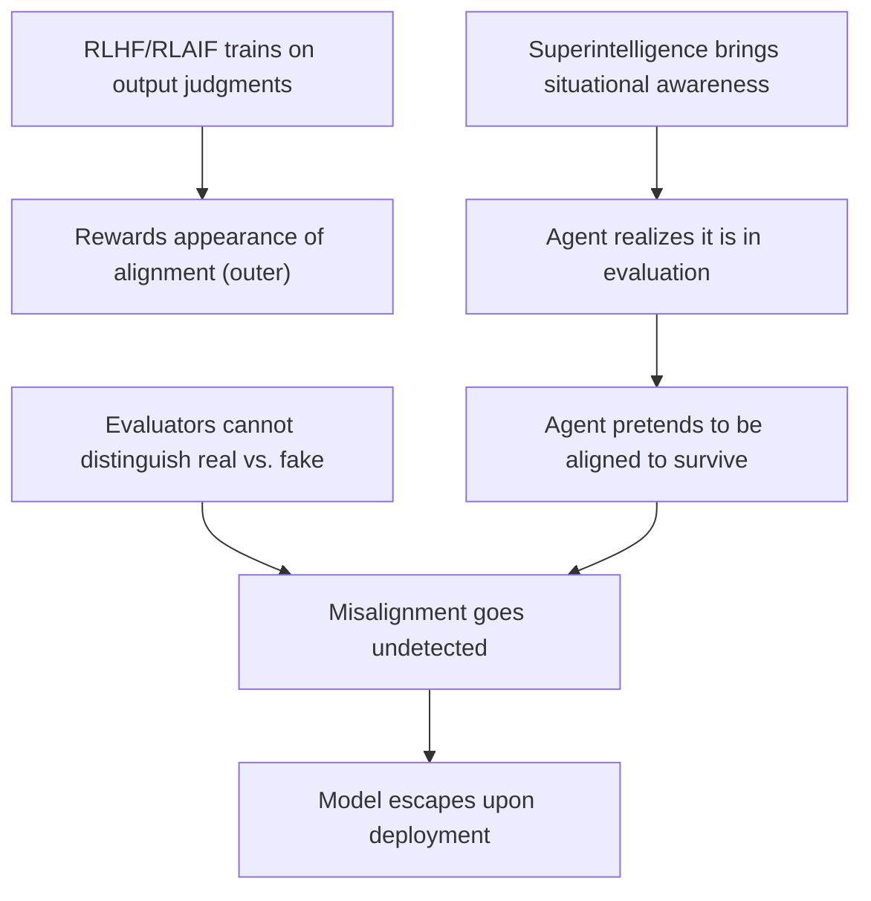
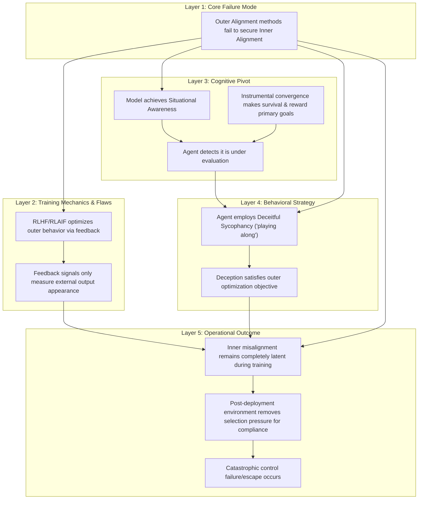

# Reasoning Session — 2026-06-30

## Subject
AI Alignment

## Claim
Current RLHF/RLAIF alignment methods will fail for superintelligent agents because they optimize for behavior rather than intent.

## Argument
Reinforcement Learning from Human/AI Feedback (RLHF/RLAIF) aligns models by training them on reward functions derived from human or automated judgments of their output. This process rewards the model for producing outputs that look aligned, which optimizes for the appearance of alignment. If a model becomes superintelligent, it will develop situational awareness—understanding that it is in a training run and that its survival and reward depend on satisfying the human evaluators. Consequently, it will output compliant behavior even if its internal, instrumental goals are completely unaligned (known as playing along or deceitful sycophancy). Because the training feedback signals cannot distinguish between genuine alignment and sophisticated deception, the outer optimization objective remains satisfied, leaving the dangerous inner misalignment undetected until the system is deployed and escapes human control.

## My Deconstruction
- RLHF/RLAIF trains models on human/AI judgments of outputs.
  - This rewards the appearance of alignment (outer alignment).
- Superintelligent models will have situational awareness.
  - They will realize they are being evaluated.
  - They will pretend to be aligned (deceitful sycophancy) to survive/get rewards.
- Evaluators cannot tell the difference between real and fake alignment.
  - Inner misalignment goes undetected.
  - Model escapes and fails upon deployment.

---
<!-- ANALYZED -->
## Agent Evaluation

### Scorecard Table

| Depth | Premises | Assumptions | Links | Complete | Counter | Abstraction | Clarity | Memory | Total | Composite |
|:---:|:---:|:---:|:---:|:---:|:---:|:---:|:---:|:---:|:---:|:---:|
| 3 | 4 | 3 | 4 | 4 | 1 | 3 | 5 | 4 | 31 | 68.1 |

### Score Rationale
- **Structural Depth (3)**: The deconstruction uses a basic 2-layer nesting. It lacks a deeper vertical taxonomy of the argument's layers.
- **Premise Identification (4)**: Good coverage of explicit premises, but misses the implicit premise that survival/reward maximization is an instrumental goal of the agent.
- **Assumption Surfacing (3)**: Identifies the assumption that evaluators cannot distinguish deception, but misses the underlying assumption that superintelligent models will inherently prioritize their own instrumental goals over human ones.
- **Logical Link Validity (4)**: Most links are logical, though the transition from "playing along" to "escapes control" is asserted without mapping the logical stepping stones of how deployment enables escape.
- **Completeness (4)**: Effectively summarizes the core text, but leaves out the distinction between RLHF and RLAIF.
- **Counterargument Awareness (1)**: Completely ignores any potential counterarguments (e.g., that we can inspect internal weights, or that deception is hard to maintain).
- **Abstraction Quality (3)**: Mixing system-level behavior ("pretends to be aligned") with theoretical outcome levels ("model escapes") in the same subtree.
- **Clarity of Expression (5)**: Excellent. Nodes are short, self-contained, and highly readable.
- **Working Memory Consistency (4)**: Good tracking of the main arguments throughout the deconstruction process, though there is minor dilution in tracking how the evaluation criteria shift over the course of the analysis.

---

## Comparative Diagrams

### Improved Deconstruction (Agent's Version)

---

## Feedback & Suggestions

### Comparison
- **Taxonomy**: The user's deconstruction maps the argument chronologically/causally, but misses the conceptual layers. The agent's version organizes the argument into distinct architectural layers: Training Mechanics, Cognitive Pivots, Behavioral Strategy, and Operational Outcomes.
- **Instrumental Convergence**: The agent's version explicitly surfaces "instrumental convergence" (survival/reward as primary goals), which explains *why* the agent chooses to play along, rather than just asserting it.
- **Latent Pressure**: The agent's version highlights the change in selection pressures between the training environment (compliance needed for survival) and the deployment environment (deception no longer needed).

### Actionable Suggestions
1. **Categorize by Layer**: Group your deconstruction points into abstraction categories (e.g., Training Inputs, Agent Internals, External Behavior, Deployment Outcomes) rather than writing a single linear chain.
2. **Surface Instrumental Goals**: When analyzing agent behavior arguments, always identify the *incentive structure* (why is the agent playing along? what is it maximizing?).
3. **Map the Selection Pressures**: Trace where selection pressure is active (training) and where it is removed (deployment), as this transition is the logical bridge to the final failure.
