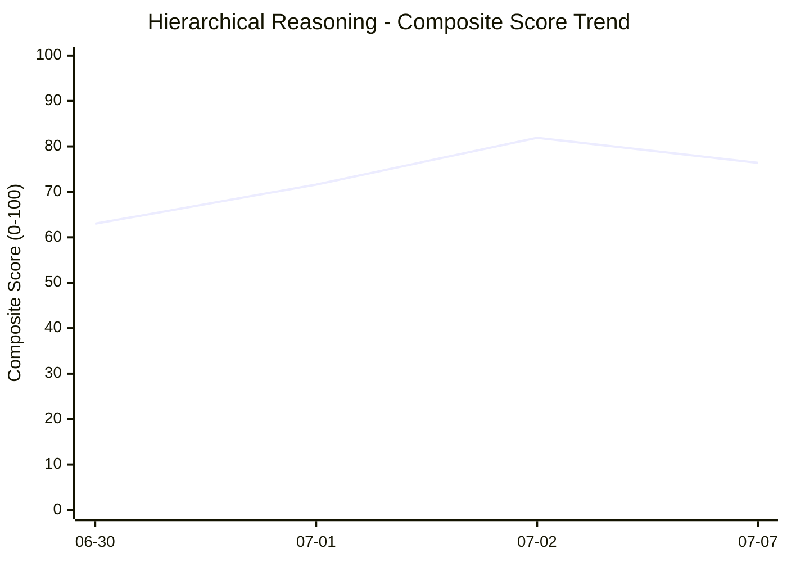

# Progress Tracker

This file logs your scores over time to track your progress in argument deconstruction.

| Date | Topic | Depth | Premises | Assumptions | Links | Complete | Counter | Abstraction | Clarity | Memory | Total | Composite |
| :---: | :--- | :---: | :---: | :---: | :---: | :---: | :---: | :---: | :---: | :---: | :---: | :---: |
| 2026-06-30 | AI Awareness | 3 | 4 | 2 | 4 | 4 | 1 | 3 | 5 | 3 | 29 | 63.0 |
| 2026-07-01 | Vacation Planning | 4 | 4 | 2 | 4 | 5 | 1 | 3 | 5 | 5 | 33 | 71.6 |
| 2026-07-02 | Stock Market Strategy | 3 | 5 | 3 | 4 | 5 | 5 | 3 | 5 | 5 | 38 | 81.9 |
| 2026-07-07 | Space-Time and Subjectivity of Time | 3 | 5 | 3 | 4 | 5 | 1 | 4 | 5 | 5 | 35 | 76.4 |

## Rolling Trend (Last 7 Sessions)

