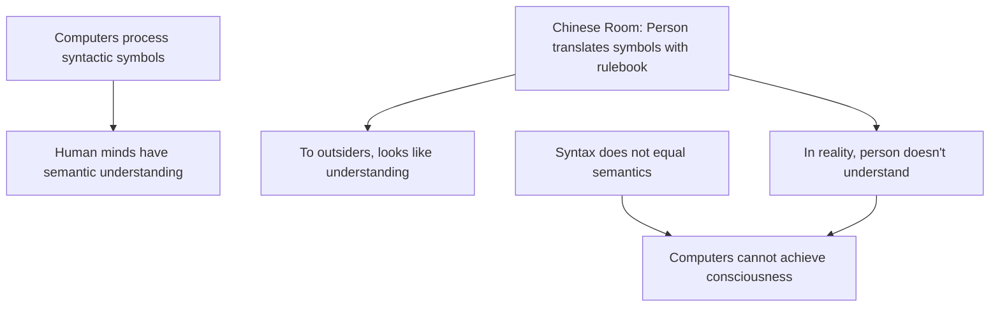
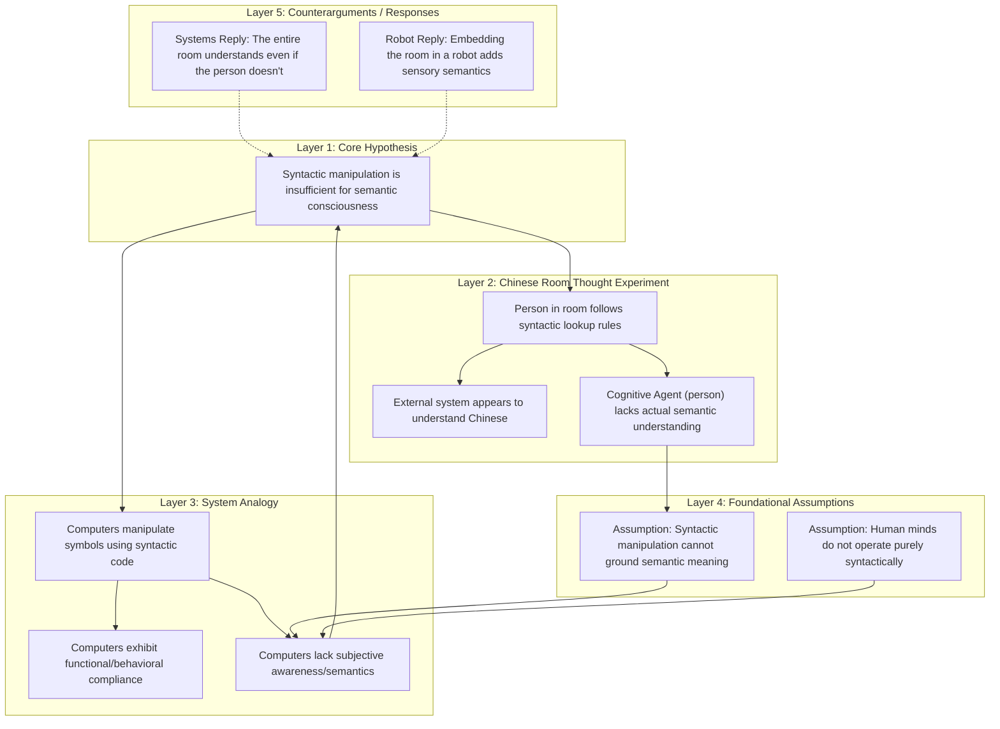

# Reasoning Session — 2026-06-30

## Subject
AI Awareness & Consciousness

## Claim
Computers can never achieve genuine consciousness or awareness because syntactic symbol manipulation is fundamentally distinct from semantic understanding.

## Argument
Machine consciousness is impossible because computers only process syntactical symbols, whereas human minds possess semantic understanding. This is illustrated by John Searle's Chinese Room argument: a person inside a room who does not speak Chinese can translate symbols using a rulebook, appearing to understand Chinese to observers outside, but they do not actually understand the language. Similarly, a computer executing a program is just manipulating physical symbols based on syntactic rules. Because syntax is not sufficient for semantics, and human minds have semantics, a computer executing a program can never achieve genuine awareness, consciousness, or understanding.

## My Deconstruction
- Computers process syntactic symbols using rules.
  - Human minds have semantic understanding (meaning).
- John Searle's Chinese Room argument shows:
  - A person inside a room translates Chinese symbols using a rulebook.
  - To outsiders, it looks like they understand Chinese.
  - In reality, the person inside does not understand Chinese.
- Rule-following syntax does not equal semantic understanding.
  - Therefore, computers cannot achieve consciousness or awareness.

---
<!-- ANALYZED -->
## Agent Evaluation

### Scorecard Table

| Depth | Premises | Assumptions | Links | Complete | Counter | Abstraction | Clarity | Memory | Total | Composite |
|:---:|:---:|:---:|:---:|:---:|:---:|:---:|:---:|:---:|:---:|:---:|
| 3 | 4 | 2 | 4 | 4 | 1 | 3 | 5 | 3 | 29 | 63.0 |

### Score Rationale
- **Structural Depth (3)**: The deconstruction uses a basic 2-layer nesting. It lacks a deeper vertical taxonomy of the argument's layers.
- **Premise Identification (4)**: Good job identifying the primary explicit premises. However, it misses the crucial premise that human minds do possess semantic understanding, which Searle uses as his contrast.
- **Assumption Surfacing (2)**: Identifies the conclusion that syntax != semantics, but fails to surface Searle's core unstated assumptions, such as the assumption that the brain itself doesn't just perform syntactic computations at a physical level.
- **Logical Link Validity (4)**: The logic flows well, but the leap from the Chinese Room scenario to the impossibility of machine consciousness is direct rather than tracing the systemic mapping.
- **Completeness (4)**: Captures the main parts of Searle's argument but omits his specific focus on "program execution" as the target of the critique.
- **Counterargument Awareness (1)**: The deconstruction is entirely one-sided; it does not map or acknowledge standard objections to Searle's room (e.g., the Systems Reply or the Robot Reply).
- **Abstraction Quality (3)**: The thought experiment details are mixed directly with general philosophical principles in the same hierarchical level.
- **Clarity of Expression (5)**: Excellent clarity. Every bullet point is crisp, concise, and easy to follow.
- **Working Memory Consistency (3)**: The mental map drifted slightly mid-deconstruction. The distinction between syntactic rule-following (rulebook lookup) and structural processing was partially muddled as the deconstruction progressed to the final conclusion.

---

## Comparative Diagrams

### User's Deconstruction (Mermaid)

### Improved Deconstruction (Agent's Version)

---

## Feedback & Suggestions

### Comparison
- **Structural Separation**: The user's deconstruction blends the analogy (Chinese Room) and the general case (computers) chronologically. The agent's version explicitly separates the Chinese Room domain from the computer domain, mapping their corresponding elements side-by-side to highlight the analogy.
- **Surfacing Assumptions**: The agent's version isolates the foundational axioms that must hold true for Searle's argument to work, which are usually the primary points of contention.
- **Counter-Paths**: The agent's version maps alternative logical outcomes (the replies), showing where the argument's structure is contested.

### Actionable Suggestions
1. **Map Analogies Horizontally**: When analyzing an analogy, map both sides of the comparison (the Chinese Room vs. the computer system) at the same level of abstraction to verify if the mapping is tight.
2. **Explicitly Extract Foundational Axioms**: Look for what the author is assuming about the human brain. In this case, Searle assumes that biological brains have a unique causal power to produce semantics that silicon cannot replicate.
3. **Incorporate Criticisms**: To train a more robust model of the argument, identify where the structure is vulnerable and add branches for the most famous counterarguments (like the Systems Reply).
