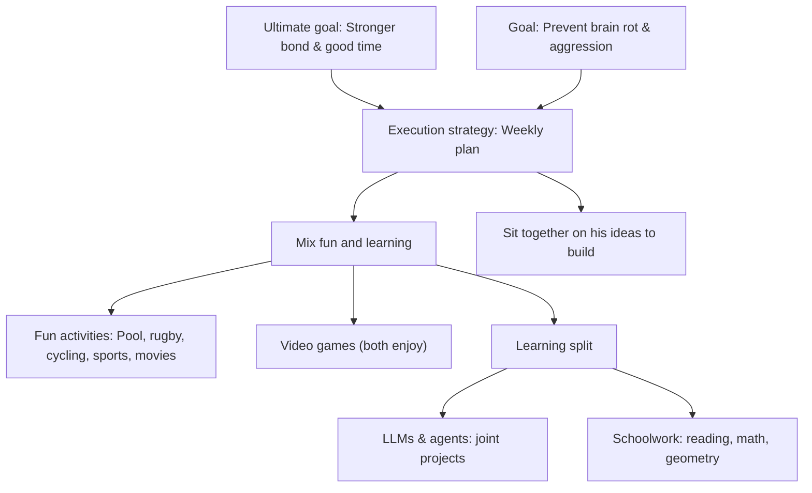
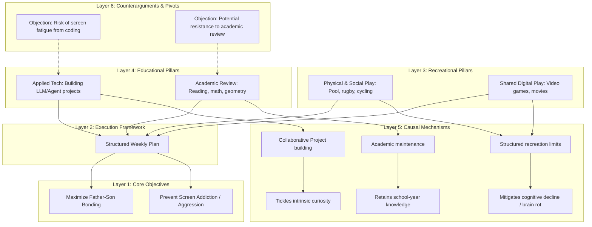

# Reasoning Session — 2026-07-01

## Subject
Vacation Planning with my Son: Fun, Learning, and Bonding

## Claim
A successful summer vacation with my son requires a structured weekly plan that balances fun, physical, and digital recreation with active learning (especially AI agents and academic review) to prevent cognitive stagnation, prevent screen addiction, and strengthen our bond.

## Argument
To have a balanced and successful vacation with my son, we need a plan that combines fun and learning. The fun activities include things we both enjoy or that are good for us, like swimming in the pool, playing on the rugby pitch, riding bicycles, playing sports, watching movies, and playing video games. The learning component is split into two: first, introducing him to AI agents and LLMs by working together on ideas he wants to build; and second, maintaining academic progress by reading, studying mathematics, and doing geometry so he doesn't forget what he learned in school. A structured weekly plan containing a mixture of these activities will keep him engaged, stimulate curiosity about new and old topics, prevent 'brain rot' and aggression from unstructured computer use, and ultimately build a stronger bond between us.

## My Deconstruction
- A successful vacation plan must mix fun and learning.
  - Fun activities: going to the pool, playing rugby on the pitch, riding bicycles, playing sports, and watching movies.
  - Video games are also part of the fun, as we both enjoy them.
- Learning is split into two parts:
  - Working with AI agents and LLMs, making them accessible to him through joint projects.
  - Keeping up with schoolwork: reading, mathematics, and geometry to prevent forgetting.
- The execution strategy:
  - Create a structured weekly plan mixing these fun and learning elements.
  - Sit together to work on tasks and ideas he wants to build to tickle his curiosity.
- The ultimate goal:
  - Create a stronger bond and have a good time together.
  - Prevent "brain rot", computer addiction, and aggressive behavior.

---
<!-- ANALYZED -->
## Agent Evaluation

### Scorecard Table

| Depth | Premises | Assumptions | Links | Complete | Counter | Abstraction | Clarity | Memory | Total | Composite |
|:---:|:---:|:---:|:---:|:---:|:---:|:---:|:---:|:---:|:---:|:---:|
| 4 | 4 | 2 | 4 | 5 | 1 | 3 | 5 | 5 | 33 | 71.6 |

### Score Rationale
- **Structural Depth (4)**: The deconstruction utilizes multiple levels of nesting to group activities and execution, but could benefit from a clearer categorization of the dimensions of development.
- **Premise Identification (4)**: Successfully captures the core components of the plan (fun, learning splits, and execution), though it glosses over the exact mechanism of computer-related aggression.
- **Assumption Surfacing (2)**: Identifies the goal of avoiding screen-related "brain rot" but fails to surface assumptions like whether LLM development will successfully bypass screen addiction.
- **Logical Link Validity (4)**: The logical progression from vacation requirements to plan design is clear, but could explicitly draw links between specific activities and their targeted goals.
- **Completeness (5)**: Thoroughly captures all details mentioned in the transcript, including specific sports, academic subjects, and bonding intentions.
- **Counterargument Awareness (1)**: Completely one-sided; does not address potential points of failure, such as the son's lack of interest in math/geometry or scheduling conflicts.
- **Abstraction Quality (3)**: Mostly clean, but places specific details (like shared enjoyment of video games) on the same tier as high-level categories.
- **Clarity of Expression (5)**: Every node is written as a clear, concise, and self-contained statement.
- **Working Memory Consistency (5)**: Maintains an accurate, cohesive structure throughout the spoken thoughts without any logical drift or duplication.

---

## Comparative Diagrams

### User's Deconstruction (Mermaid)

### Improved Deconstruction (Agent's Version)

---

## Feedback & Suggestions

### Comparison
- **Structural Separation**: The user's deconstruction blends the goals, activities, and strategies hierarchically but in a somewhat unstructured way. The agent's version organizes these into logical layers: Objectives, Execution Framework, Activity Pillars (divided into physical/digital and tech/academic), and Causal Mechanisms.
- **Unveiling Mechanisms**: The agent's version explicitly maps the *mechanisms* (e.g., collaborative coding -> curiosity, active review -> retention) rather than just listing activities, showing *why* each part is in the plan.
- **Mitigating Objections**: The agent's version introduces counter-paths/objections, such as potential resistance to academic review or coding-related screen fatigue, allowing for proactive planning.

### Actionable Suggestions
1. **Differentiate Screen Types**: Explicitly distinguish between passive/isolated screen time (susceptible to addiction/aggression) and active/collaborative screen time (LLM project building).
2. **Define Feedback Loops**: Map out how child curiosity feeds back into the plan. If the son proposes an idea, how is it scoped to fit the weekly schedule?
3. **Plan for Resistance (Pivots)**: Add a branch for adjusting academic rigor (e.g., gamifying mathematics or geometry) if the son resists schoolwork during vacation.
