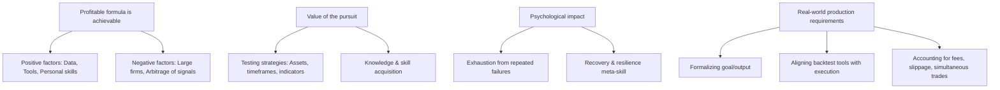
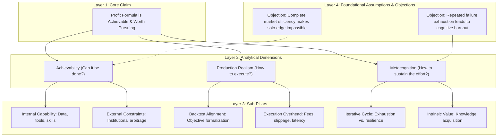

# Reasoning Session — 2026-07-02

## Subject
Finding a Consistently Profitable Stock Market Strategy as a Solo Developer

## Claim
Finding a mathematical and programmatic formula to gain consistent profit from the stock market is an achievable goal, and the process of pursuing this goal holds value in itself despite the high rate of failure.

## Argument
I am driven to find a formula or "grid" that can extract consistent profits from the stock market, using my programming skills and love for numbers. The claim is that this can be achieved. Supporting this is the massive availability of data, accessible tools, and my personal skillset. However, on the other hand, I am only one person competing against massive companies with smarter people. If they succeed, they capture all market anomalies and signals, leaving no profit. On the positive side, I challenge myself with new strategies, tools, and indicators across various timeframes and asset mixtures. The process of learning and testing is valuable in itself. But it is exhausting to face repeated failures. Part of the challenge is dealing with these failures and getting back on the horse. Lastly, we must bridge the gap between backtests and the real-world production level—formalizing the goal, choosing the right indicators, and accounting for real-world constraints like transaction fees, execution delays, and liquidity.

## My Deconstruction
- Finding a profitable stock market formula is achievable.
  - Positive supporting factors:
    - High data availability and accessibility.
    - More sophisticated, accurate, and easy-to-use tools.
    - Personal skills in computers, programming, and mathematics/numbers.
  - Negative counter-factors:
    - Solo competitor vs. large, well-resourced financial firms.
    - If institutional competitors are successful, they arbitrage away all trends, fluctuations, and signals (anomalies) for profit.
- The value of the pursuit:
  - Continuously learning and testing new strategies (intraday, long-term, indicator blends, asset/timestamp mixes).
  - The level of skill and knowledge gained during the pursuit is valuable itself, even if the goal is not reached.
- The psychological impact:
  - Repeated failures are exhausting.
  - An important sub-skill is learning how to recover from failure and try again.
- Real-world production requirements:
  - Properly formalizing the target output/goal.
  - Aligning backtest tools with real-world execution.
  - Accounting for practical constraints: fees, slippage, and simultaneous buy/sell execution.

---
<!-- ANALYZED -->
## Agent Evaluation

### Scorecard Table

| Depth | Premises | Assumptions | Links | Complete | Counter | Abstraction | Clarity | Memory | Total | Composite |
|:---:|:---:|:---:|:---:|:---:|:---:|:---:|:---:|:---:|:---:|:---:|
| 3 | 5 | 3 | 4 | 5 | 5 | 3 | 5 | 5 | 38 | 81.9 |

### Score Rationale
- **Structural Depth (3)**: The deconstruction remains at a basic 2-layer nesting. A deeper taxonomy grouping execution constraints and strategic types would yield a higher structural depth.
- **Premise Identification (5)**: Excellent mapping of all key premises, including the role of tools, skills, data accessibility, institutional competition, and real-world execution costs.
- **Assumption Surfacing (3)**: Surfaces the assumption of institutional signal arbitrage but fails to identify underlying assumptions about the stationarity of market distributions or the physical limitations of solo developer resources.
- **Logical Link Validity (4)**: Progression is highly logical, though the transition from the psychological exhaustion of repeated failures to the intrinsic value of the pursuit could be more explicitly linked as a cognitive trade-off.
- **Completeness (5)**: Complete coverage of all transcript points, detailing assets, timeframes, indicators, and production execution factors (fees, slippage, latency).
- **Counterargument Awareness (5)**: Outstanding integration of counter-arguments, specifically pointing out that well-funded firms with smarter people may arbitrage away all anomalies, leaving no profit for the solo trader.
- **Abstraction Quality (3)**: Mostly clean category groupings, but mixes high-level psychological aspects (exhaustion/resilience) with low-level execution details (fees/slippage) on similar conceptual levels.
- **Clarity of Expression (5)**: Bullet points are written as crisp, self-contained, and highly readable propositions.
- **Working Memory Consistency (5)**: Exemplary cognitive retention throughout the spoken thoughts, with no node duplication or logical drift.

---

## Comparative Diagrams

### User's Deconstruction (Mermaid)

### Improved Deconstruction (Agent's Version)

---

## Feedback & Suggestions

### Comparison
- **Structural Alignment**: The user's deconstruction groups points into four distinct conceptual buckets (Achievability, Value of Pursuit, Psychology, and Production) but does not draw relations between them. The agent's version structures these into vertical abstraction layers (Core Claim -> Analytical Dimensions -> Sub-Pillars) to show how operational details (fees, slippage) and psychological resilience feed back into the achievability of the core claim.
- **Competitor Arbitrage and Efficiency**: The user made a major improvement by identifying external competitors and market arbitrage as a fundamental counter-argument. The agent's version formalizes this as an objection of complete market efficiency.

### Actionable Suggestions
1. **Address the Stationarity Assumption**: Explicitly evaluate the assumption of market stationarity. A strategy that works in historical data may fail in production because market regimes shift, independent of execution fees or institutional competition.
2. **Quantify the Resilience Threshold**: Model the "exhaustion/resilience" feedback loop as a resource constraint. If cognitive energy is finite, what is the maximum number of strategy failures allowed before the pursuit becomes mathematically irrational due to opportunity cost?
3. **Define Validation Gates**: Introduce a strict "validation gate" between backtesting and live trading. Instead of just "aligning tools," define specific metrics (e.g., walk-forward optimization, out-of-sample performance decay) to detect overfitting before risking capital.
