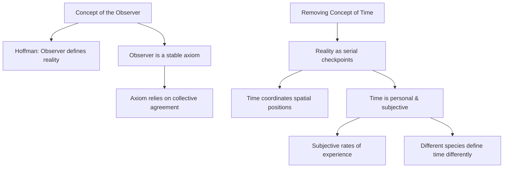
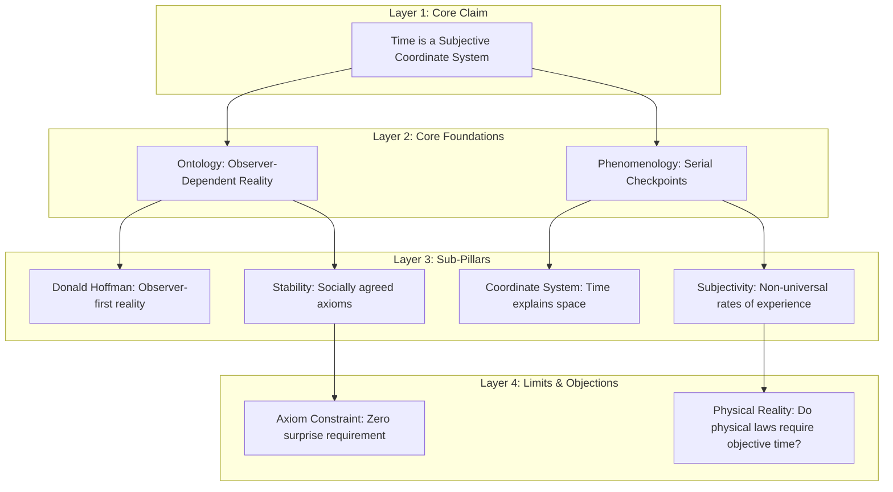

# Reasoning Session — 2026-07-07

## Subject
Space-Time and the Subjectivity of Time in Consciousness

## Claim
Time is not an objective physical constant, but a personal metric of consciousness used to coordinate sequential spatial checkpoints.

## Argument
This is a thought deconstruction. Today I'm thinking about the meaning of time in the context of space-time, trying to understand if it is the main cause to understand the nature of the outer surrounding. I am trying to think how it is to be without time, to eliminate the concept of time. I think about the concept of layers of sense that are being recorded as traces. One trace comes after another. Every point is a place, and changing the distance between points from A to B is what we call time past. Without time, it would be like magic: one minute here, and the next thing I'm there. My claim is that it's all about the consciousness of the person; realism keeps surrounding me, and time is personal for consciousness (per person). The objective concept of time we use today is just a mechanism to collectively coordinate our placements in space. I break this down: First, the concept of the Observer. Following Donald Hoffman, the observer is the missing data to define reality, which depends on how an observer observes a phenomenon. This is an axiom or assumption we rely on (the collective agreement on how we see reality) with a zero surprise effect. Second, removing time means everyone experiences reality as a serial checkpoint of spatial positions, which we explain using the concept of time. Therefore, we can experience time differently from one another, and our definitions of time differ (for example, comparing a human experience of time to that of a fly).

## My Deconstruction
- The concept of the Observer:
  - Donald Hoffman's view: the observer is the missing data to define reality (an axiomist). Reality depends on how the observer observes a phenomenon.
  - The observer's role is an assumption/agreement (an axiom) with a zero surprise effect.
  - This axiom depends on the collective agreement on how they see reality.
- Removing the concept of time:
  - Without time, reality is experienced as a serial checkpoint (a point where consciousness realizes its position in space).
  - The concept of time is simply how we explain/coordinate these spatial positions.
  - Time is personal and subjective:
    - I can experience time differently from another human being without a shared rhythm of time.
    - Comparing a human experience of time to a fly's experience shows different definitions/rates of time.

---
<!-- ANALYZED -->
## Agent Evaluation

### Scorecard Table

| Depth | Premises | Assumptions | Links | Complete | Counter | Abstraction | Clarity | Memory | Total | Composite |
|:---:|:---:|:---:|:---:|:---:|:---:|:---:|:---:|:---:|:---:|:---:|
| 3 | 5 | 3 | 4 | 5 | 1 | 4 | 5 | 5 | 35 | 76.4 |

### Score Rationale
- **Structural Depth (3)**: The user deconstruction reaches a depth of 3 layers but could benefit from a higher-level classification separating ontology from physical coordinates.
- **Premise Identification (5)**: Excellent identification of all explicit claims from the transcript, including the observer's role, serial checkpoints, and species-relative time.
- **Assumption Surfacing (3)**: Surfaces the assumption that the observer model is an axiom with a "zero surprise effect," but does not evaluate what physical reality would look like if this assumption is violated.
- **Logical Link Validity (4)**: Highly logical flows, though the connection between observer-dependency and time-removal remains associative rather than strictly deductive.
- **Completeness (5)**: Successfully captures the entirety of the spoken text, missing no major points.
- **Counterargument Awareness (1)**: The deconstruction is entirely one-sided; it does not address common counter-claims (e.g., the objective consistency of physical constants in physics).
- **Abstraction Quality (4)**: Mostly clean taxonomy, with minor mixing of high-level philosophical concepts and specific animal comparisons.
- **Clarity of Expression (5)**: Every point is a short, readable, self-contained proposition.
- **Working Memory Consistency (5)**: Perfect retention throughout the spoken deconstruction; no duplicate concepts or structural drift.

---

## Comparative Diagrams

### User's Deconstruction (Mermaid)

### Improved Deconstruction (Agent's Version)

---

## Feedback & Suggestions

### Comparison
The user deconstruction captures all key points from the transcript. However, it lacks vertical integration: the observer section and the time-less coordinate section are presented in isolation. The improved version establishes that the observer-first ontology dictates the stability of the coordinates, showing that subjective time rate variability directly derives from this.

### Actionable Suggestions
1. **Vertical Integration**: Link the Hoffman observer model directly to the checkpoint model of time, illustrating that the serial nature of checkpoints is a function of observer perception.
2. **Explore the Zero Surprise Axiom**: Discuss the consequences of violating the "zero surprise" requirement. What happens when collective agreements on spatial positioning break down?
3. **Address Counter-Arguments**: Introduce an objection node exploring how objective physical constants (like the speed of light) can be reconciled with a purely personal, subjective model of time.
