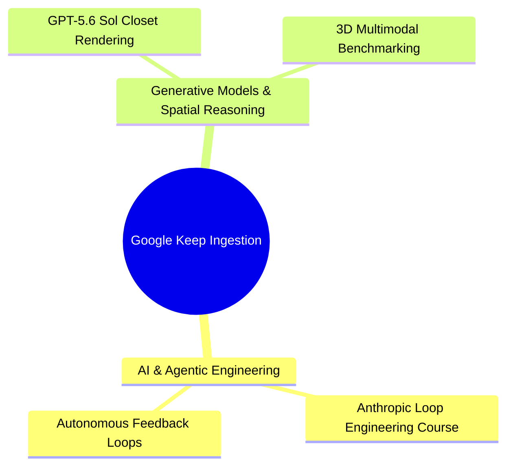

---
tags:
  - resource/keep-digest
  - status/triage
date: 2026-07-15
source: Google Keep Export
---

# 📝 Google Keep Digest & Analysis — 2026-07-15

> [!note] Ingestion Summary
> Evaluated Google Keep items from the past 24 hours.
> Each item has been analyzed for **Value / Further Reading Potential** and **Practical Vault & Engineering Application** with dedicated [[Wikilinks]] mapping.

---

## 1. Executive Thematic Clusters

---

## 2. Itemized Analysis & Vault Integration

### 1. 🎓 Anthropic Course
- **Content**: Anthropic Loop Engineering course bookmark
- **Timestamp**: `2026-07-15T09:45:00Z`
- **Worth Further Reading**: ==Yes (High Priority)==. Loop engineering and agentic feedback workflows are critical for autonomous coding, self-healing code loops, and robust multi-step agents.
- **How to Use**: Integrate core principles into [[Agentic Loops]] and reference when designing autonomous harness workflows.

> [!tip] Practical Vault Application
> Apply course insights directly to prompt-loop architectures and multi-agent coordination frameworks in [[LLM Orchestration]].

---

### 2. ⚡ GPT-5.6 Sol
- **Content**: Thijs tweet about GPT-5.6 Sol closet rendering
- **Timestamp**: `2026-07-15T08:12:00Z`
- **Worth Further Reading**: ==Yes (Medium Priority)==. Highlights advancements in frontier model capabilities, specifically dense spatial geometry, 3D rendering understanding, and photorealistic physics.
- **How to Use**: Link under [[Quantum Realms]] / [[ThreeJS]] for spatial generation research and benchmark against upcoming frontier multi-modal releases.

> [!note] Practical Vault Application
> Track evolution of spatial 3D reasoning benchmarks in [[AI Models & Benchmarks]].

---

## 3. Filtered Items (Older than 24 Hours)

- **Old Note** (`2026-07-01T12:00:00Z`): Excluded from active digest due to 24-hour ingestion cutoff.
