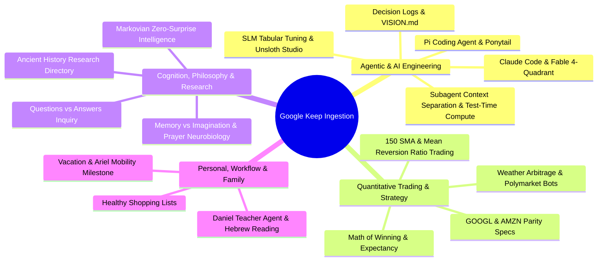

---
tags:
  - resource/keep-digest
  - status/triage
date: 2026-08-19
source: Google Keep Export
---

# 📝 Google Keep Digest & Analysis — 2026-08-19

> [!note] Ingestion Summary
> Evaluated **97 Google Keep items** scraped on **August 19, 2026, 10:04 AM**.
> Each item has been analyzed for **Value / Further Reading Potential** and **Practical Vault & Engineering Application** with dedicated [[Wikilinks]] mapping.

---

## 1. Executive Thematic Clusters

---

## 2. Itemized Analysis & Vault Integration

### 1. 📈 [PINNED] GOOGL Trading Strategy Spec (TradingView Parity & Goal Loop)
- **Content**: `[strategy-tv-parity][/goal]` spec targeting GOOGL (>15m timeframe, 2026-01-01 to 2026-05-31 train, 2026-06-01 to 2026-08-01 holdout) with ≥30 trades, >2% average expectancy per trade after costs, verified on TradingView.
- **Worth Further Reading**: ==Yes (High Priority)==. Clear benchmark spec with out-of-sample holdout validation to prevent overfitting.
- **How to Use**: Execute directly via `/goal` and Jesse/TradingView parity harness in [[Trading Experiments/GOOGL Strategy]].

---

### 2. 📖 ASD-STE100 Simplified Technical English
- **Content**: Reference to ASD-STE100 (Simplified Technical English) specification for clear, controlled writing.
- **Worth Further Reading**: ==Yes (High Priority)==. Exceptional standard for writing deterministic system prompts and agent rules.
- **How to Use**: Integrate ASD-STE100 controlled vocabulary principles into agent prompt guidelines and [[Agent Orchestration/Prompt Standards]].

---

### 3. 🛠️ Pi Coding Agent — Top 10 Essential Extensions
- **Content**: Curated setup for Pi daily coding agent: `Ponytail` (stdlib reuse, anti-overengineering), `pi-web-access` (web search, SearXNG, PDF/video reading).
- **Worth Further Reading**: ==Yes (High Priority)==. Direct overlap with local tooling stack.
- **How to Use**: Audit `.agents/skills/` and adapt missing Pi extension workflows into [[Agent Tooling & Extensions]].

---

### 4. 📈 AMZN Trading Strategy Holdout Spec
- **Content**: NASDAQ:AMZN strategy specification strictly above 15m (prefer 1h RTH). Frozen train window (2026-01-01 → 2026-05-31), zero-retuning evaluation window (2026-06-01 → 2026-08-01).
- **Worth Further Reading**: ==Yes (High Priority)==. Complements GOOGL test suite for multi-asset robustness.
- **How to Use**: Run in parallel with GOOGL strategy backtests inside [[Trading Experiments/AMZN Holdout Evaluation]].

---

### 5. 🎙️ Audio Transcriber GitHub Repository
- **Content**: Link to `https://github.com/razamit/audio_transcriber` for local audio transcription workflows.
- **Worth Further Reading**: ==Yes (Medium Priority)==. Compare features against local Whisper `/transcribe` skill.
- **How to Use**: Benchmark transcription accuracy and latency against local Whisper pipelines in [[Audio Transcription Pipelines]].

---

### 6. 🛸 Mesopotamian Creation Traditions & Divine Labor
- **Content**: Hypothesis examining human creation mythos in Sumerian/Mesopotamian traditions — exploring whether human labor served cosmic functions beyond manual tasks.
- **Worth Further Reading**: ==Yes (Medium Priority)==. Rich conceptual bridge between ancient myth and cosmological models.
- **How to Use**: Document under [[Ancient Civilizations/Mesopotamian Labor Hypotheses]] linked with cuneiform translations.

---

### 7. 🏛️ History Research Directory
- **Content**: Research index covering Göbekli Tepe, Atlantis, Sumer, Egypt, Ancient Greece, Epic of Gilgamesh, and Younger Dryas flood event.
- **Worth Further Reading**: ==Yes (Standard Reference)==. Master index for historical inquiries.
- **How to Use**: Maintain as vault hub [[Ancient Civilizations/History Research Index]].

---

### 8. 💡 Refined Core Thought: Inquiry vs Answers
- **Content**: "In conversation, asking questions is far more engaging than receiving answers—answers conclude a topic, but ongoing inquiry drives deeper reality exploration."
- **Worth Further Reading**: ==Yes (High Priority)==. Foundational epistemic mindset for interactive agents.
- **How to Use**: Embed into `/interview-me` and [[Doubt-Driven Development]] guidelines.

---

### 9. 🚀 Codex Deployment Worker via Luna Max
- **Content**: Cost-effective deployment tip using Luna Max model in a dedicated thread to merge PRs, run tests, and push deployments.
- **Worth Further Reading**: ==Yes (High Priority)==. Saves primary high-reasoning tokens on deterministic CI/CD tasks.
- **How to Use**: Add dedicated deployment agent trigger to [[Agentic CI-CD Workflows]].

---

### 10. 🧘 Imagination to Reality & Plant Manifestation
- **Content**: Guided visualization practice (seeding, watering, nurturing) to clear mental clutter and prime subconscious for desired future outcomes.
- **Worth Further Reading**: ==Yes (Medium Priority)==. Practical mental model for focus and intention setting.
- **How to Use**: Include in daily morning standup routine templates under [[Mindset & Mental Models]].

---

### 11. 🧠 Memory vs Dream vs Imagination
- **Content**: Epistemological inquiry into the temporal independence of memory, dreams, and imagination on current consciousness.
- **Worth Further Reading**: ==Yes (Medium Priority)==. Relevant for cognitive architecture design.
- **How to Use**: Synthesize into [[Cognitive Science/Consciousness Models]].

---

### 12. 🔬 Neurobiology & Consciousness of Prayer
- **Content**: Exploration of physiological and neurological changes induced in the human brain during contemplative prayer.
- **Worth Further Reading**: ==Yes (Medium Priority)==. Connects contemplative practices to neuroplasticity.
- **How to Use**: File under [[Neuroscience/Contemplative States & Brainwave Modulation]].

---

### 13. ⚙️ Luna Max Subagent Setup (`luna_worker`)
- **Content**: Custom agent setup prompt for `~/.codex/agents/luna-worker.toml` using `gpt-5.6-luna` with `model_reasoning_effort = "max"`.
- **Worth Further Reading**: ==Yes (High Priority)==. Reusable subagent template.
- **How to Use**: Configure in Codex/AGY toolchains under [[Agent Orchestration/Subagent Profiles]].

---

### 14. 🎓 Grilling Session Handoff Pattern
- **Content**: Workflow for high-pressure code reviews: `/handoff` -> teaching workspace with `/teach` skill -> learn concept -> return to grilling session.
- **Worth Further Reading**: ==Yes (High Priority)==. Eliminates hallucinations and context degradation during reviews.
- **How to Use**: Standardize in developer rules and [[Agent Orchestration/Handoff Protocols]].

---

### 15. 📜 Decision Log Mandate (`decisions.md`)
- **Content**: Architectural mandate requiring `decisions.md` in repository roots; agents must consult it before proposing solutions.
- **Worth Further Reading**: ==Yes (Standard Mandate)==. Prevents repeating failed or rejected architectural approaches.
- **How to Use**: Enforce across all active repositories via `AGENTS.md` and [[Engineering Standards/ADRs]].

---

### 16. 🗺️ A Field Guide to Fable: Finding Your Unknowns
- **Content**: 4-Quadrant framework for agentic coding aligning the map (prompts/context) with the territory (codebase/constraints) to eliminate unknowns.
- **Worth Further Reading**: ==Yes (High Priority)==. Systematic approach to minimizing agent implementation drift.
- **How to Use**: Document in [[Agentic Engineering/4-Quadrant Alignment Framework]].

---

### 17. 🔄 Claude Code Agentic Loop One-Liner
- **Content**: Autonomous pytest test-driven loop command using `claude -p` with restricted bash and edit tools.
- **Worth Further Reading**: ==Yes (High Priority)==. Compact pattern for localized TDD execution.
- **How to Use**: Reference in quick CLI cheat sheets under [[Developer Tooling/Claude CLI Loops]].

---

### 18. 🛡️ Wiz Engineering Day One
- **Content**: `https://day-one.wiz.io/` — engineering onboarding, architecture, and security practices from Wiz.
- **Worth Further Reading**: ==Yes (Medium Priority)==. High-scale cloud security and platform engineering insights.
- **How to Use**: Extract architecture patterns into [[Cloud Security & Infrastructure]].

---

### 19–21. 🌐 Curated X Posts (TheProjectUnity, Mr_Fireside, Santiago)
- **Content**:
  - `https://x.com/theprojectunity/status/2072454068472021165` (Consciousness & UAP disclosure).
  - `https://x.com/Mr_Fireside/status/2072106585397358823` (Philosophy / AI reflection).
  - `https://x.com/i/status/2071975885570441658` (Santiago @svpino on ML engineering).
- **Worth Further Reading**: ==Yes (Medium Priority)==.
- **How to Use**: Review thread insights and save bookmarks into [[Curated Feeds/X Bookmarks]].

---

### 22. 🎲 Trace Logic, Markov Chains & Minimum Surprise
- **Content**: Formulating intelligence as minimizing surprise using Markov chain models of world perception.
- **Worth Further Reading**: ==Yes (High Priority)==. Directly aligns with Free Energy Principle (Friston) and predictive processing.
- **How to Use**: Connect with [[Zero Surprise Reviews]] and [[Cognitive Architectures/Predictive Processing]].

---

### 23. 🌐 Shubham Saboo Agentic AI Post
- **Content**: `https://x.com/i/status/2071293463447097625` on state-of-the-art agent workflows.
- **Worth Further Reading**: ==Yes (Medium Priority)==.
- **How to Use**: File under [[Agentic AI Research]].

---

### 24. 👨‍👩‍👧 Family Milestone: Vacation Planning & Ariel
- **Content**: Reflection on family vacation feasibility now that Ariel has significantly improved walking abilities.
- **Worth Further Reading**: ==Personal (High Value)==. Cherished family milestone.
- **How to Use**: Add to personal vault journal [[Personal/Family Milestones 2026]].

---

### 25. 🧪 Q&A Agent Benchmark Harness
- **Content**: Framework to benchmark Q&A agents using scored datasets (Kaggle/HuggingFace), optimizing metrics, tools, and negative prompts.
- **Worth Further Reading**: ==Yes (High Priority)==. Rigorous evaluation loop for question-answering systems.
- **How to Use**: Build evaluation harness in [[Agent Benchmarking/QA Evaluation]].

---

### 26. 📊 Strategy for Maximizing Average Profit Per Trade
- **Content**: Strategy design prioritizing high average % profit per trade, candle-low stop loss, and macroeconomic data feeds (M2, 10Y yields).
- **Worth Further Reading**: ==Yes (High Priority)==. Solid framework for high-expectancy trend-following.
- **How to Use**: Integrate into [[Trading Experiments/Expectancy Maximizer Strategy]].

---

### 27. 🌐 Jason Zhou Agentic Post
- **Content**: `https://x.com/jasonzhou1993/status/2067937943545897143`.
- **Worth Further Reading**: ==Yes (Medium Priority)==.
- **How to Use**: Check agent design insights in [[Agentic AI Research]].

---

### 28. ⚖️ Ratio Trading (QQQ / BTCUSD with SMA20 Mean Reversion)
- **Content**: Mean-reversion strategy trading the QQQ/BTC ratio relative to its 20 SMA (short outperformer / long underperformer).
- **Worth Further Reading**: ==Yes (High Priority)==. Statistical arbitrage / pairs trading classic.
- **How to Use**: Model cross-asset ratio spread in [[Trading Experiments/Ratio Mean Reversion]].

---

### 29. 📐 Strata Technique with Markov Chain Modeling
- **Content**: Hierarchical pyramid of Markov transition matrices connecting broad market regime observations to micro-target execution.
- **Worth Further Reading**: ==Yes (High Priority)==. Advanced regime-switching probabilistic framework.
- **How to Use**: Design multi-scale Markov regime classifier in [[Trading Experiments/Markov Strata Modeling]].

---

### 30. 🛡️ Continuous Software Quality & Feature Discovery Agent (`/goal`)
- **Content**: Comprehensive prompt for an autonomous validation agent that discovers every feature, maps IDs, generates user stories, and writes verification tests.
- **Worth Further Reading**: ==Yes (High Priority)==. Ready-to-use `/goal` script.
- **How to Use**: Save as reusable task recipe in [[Agentic QA/Feature Discovery Goal]].

---

### 31. 👁️ Zero-Surprise Code Review Philosophy
- **Content**: Ironclad rule: "If I was surprised by something critical during the review phase, I failed." Treats review as risk management and hedging.
- **Worth Further Reading**: ==Yes (High Priority)==. Core engineering principle.
- **How to Use**: Core pillar of `AGENTS.md` and [[Engineering Standards/Zero Surprise Reviews]].

---

### 32. 🌌 Robert Monroe — Journeys Out of the Body
- **Content**: Archive.org link to foundational text on altered states of consciousness and out-of-body exploration.
- **Worth Further Reading**: ==Yes (Medium Priority)==. Pioneer literature on consciousness studies.
- **How to Use**: Index under [[Consciousness Studies/Robert Monroe Archive]].

---

### 33. 🛒 Shopping List
- **Content**: Hummus, oranges, bananas, Taster's Choice coffee, gloves, toilet paper, household items.
- **Worth Further Reading**: ==No (Routine Checklist)==.
- **How to Use**: Update household shopping list.

---

### 34. 🔄 Fresh Context for Code Review Fixes
- **Content**: Mandate for coding agents to address code review comments in a brand-new session to eliminate context bias and hallucinations.
- **Worth Further Reading**: ==Yes (High Priority)==. Core workspace rule.
- **How to Use**: Baked into `AGENTS.md` under [[Agent Operational Rules/Context Bias Mitigation]].

---

### 35. 🪜 Three-Tier Phased Planning
- **Content**: Phase 1 (Core idea in 1–2 sentences) -> Phase 2 (High-level breakdown) -> Phase 3 (Detailed breakdown with uncertainty analysis & edge cases).
- **Worth Further Reading**: ==Yes (High Priority)==. Universal planning framework.
- **How to Use**: Mandated in `AGENTS.md` and [[Planning Methodologies/Three-Tier Phased Planning]].

---

### 36. 📈 Stocks Watchlist
- **Content**: Track AVGO, NVDA, Gold/Silver, BTC/ETH, and Michael Burry portfolio filings.
- **Worth Further Reading**: ==Yes (Standard Monitoring)==.
- **How to Use**: Connect to daily data ingestion pipelines in [[Trading Experiments/Watchlist]].

---

### 37. 🧮 The Math of Winning in Trading (Mulham Trading)
- **Content**: Expectancy breakdown: $\text{Expectancy} = (\text{Win Rate} \times \text{Avg Win}) - (\text{Loss Rate} \times \text{Avg Loss})$.
- **Worth Further Reading**: ==Yes (Essential Foundation)==. Mandatory baseline for evaluating all strategy backtests.
- **How to Use**: Code into strategy KPI assertion helpers in [[Trading Experiments/Expectancy Metric Calculator]].

---

### 38. 🏢 Organizational Brain Architecture (`@Parzival_1991`)
- **Content**: Git-repo-per-department architecture transforming company operational knowledge into versioned codebases.
- **Worth Further Reading**: ==Yes (High Priority)==. Exactly parallels `second_brain` structure.
- **How to Use**: Model multi-repo knowledge synchronization in [[Knowledge Management/Git-Based Org Brain]].

---

### 39. 🎯 Prompt Success Criteria Mandate
- **Content**: Always define precise criteria for success, provide a reference format, and have a second AI agent audit the final output before completion.
- **Worth Further Reading**: ==Yes (High Priority)==. Essential verification protocol.
- **How to Use**: Codified into `AGENTS.md` and [[Prompt Engineering/Success Criteria Definition]].

---

### 40. 💰 Solo SaaS Opportunity Engine Workflow
- **Content**: Brain dump -> GPT-5.5 -> Codex prototype -> Claude Design UI -> Hermes autonomous maintenance -> Vercel + Convex stack -> Waitlist.
- **Worth Further Reading**: ==Yes (High Priority)==. Hyper-efficient solo developer launch playbook.
- **How to Use**: See existing [[SaaS Opportunity Engine]] note in vault.

---

### 41. 🔭 `VISION.md` Project Alignment Document
- **Content**: High-level guiding document defining problem, solution, goals, technical principles, and success criteria to keep AI agents aligned.
- **Worth Further Reading**: ==Yes (Standard Mandate)==.
- **How to Use**: Enforce across repos in [[Engineering Standards/Project Vision Specification]].

---

### 42. 🤖 TauricResearch/TradingAgents
- **Content**: Open-source multi-agent LLM trading and financial analysis framework (`https://github.com/TauricResearch/TradingAgents`).
- **Worth Further Reading**: ==Yes (High Priority)==. Multi-agent financial reasoning benchmark.
- **How to Use**: Evaluate agent roles (analyst, risk manager, executioner) in [[Agentic Trading/Multi-Agent Frameworks]].

---

### 43–44. 🌐 X Posts (Nate Herk & @0xcodez)
- **Content**: Autonomous agent deployment and coding workflows.
- **Worth Further Reading**: ==Yes (Medium Priority)==.
- **How to Use**: Reference in [[Agentic AI Research]].

---

### 45. 🎲 Markovian Matrices as Observing Mathematical Models
- **Content**: Exploring Markov transition matrices for stock market regime detection and goal metric tracking.
- **Worth Further Reading**: ==Yes (High Priority)==.
- **How to Use**: Prototype state-transition matrix scripts in [[Trading Experiments/Markov Transition Models]].

---

### 46–47. 🕸️ 3D Graph RAG & Spatial Knowledge
- **Content**: `3D graph rag` (`@monokern` on X) and UI interaction patterns (`@trq212`).
- **Worth Further Reading**: ==Yes (High Priority)==. Next-generation knowledge representation for second brain.
- **How to Use**: Research 3D graph visualization in [[Knowledge Graphs/3D Graph RAG]].

---

### 49. 🤝 Handoff Skill Specification (`handoff`)
- **Content**: Agent skill spec to compact conversation state into an OS temp directory handoff doc with suggested skills for fresh sessions.
- **Worth Further Reading**: ==Yes (High Priority)==.
- **How to Use**: Implement in `.agents/skills/handoff/SKILL.md` under [[Agent Orchestration/Handoff Skill]].

---

### 50. 🔁 Self-Improvement Prompt for Codex
- **Content**: 30-day retrospective prompt mining sessions, memories, and rollout summaries to extract repeated manual workflows into skills.
- **Worth Further Reading**: ==Yes (High Priority)==. Recursive self-improving agent workflow.
- **How to Use**: Run weekly to auto-generate new skills in [[Self-Improving Swarm/Retrospective Mining]].

---

### 51. 💻 `llm-checker` CLI Utility
- **Content**: Tool to detect local hardware and recommend compatible open-source LLMs (`npm install -g llm-checker`).
- **Worth Further Reading**: ==Yes (Medium Priority)==. Quick hardware profiling utility.
- **How to Use**: Test on local Mac workstation for SLM inference profiling in [[Local LLMs/Hardware Detection]].

---

### 52. 📋 `CLAUDE.md` Working Agreement Template
- **Content**: Concise tone, 300 words max, single best recommendation, explicit uncertainty flags.
- **Worth Further Reading**: ==Yes (Standard Mandate)==.
- **How to Use**: Synchronize with root workspace rules in [[Engineering Standards/Agent Work Agreements]].

---

### 53–55. 🌐 Interactive HTML Documentation vs Plain Markdown
- **Content**: Using self-contained HTML + JSON files for live interactive implementation notes, decision logs, and visual application flowcharts (`thariqs.github.io/html-effectiveness/`).
- **Worth Further Reading**: ==Yes (High Priority)==. Drastically improves agent visual comprehension and human inspection.
- **How to Use**: Experiment with HTML artifact generation in [[Documentation/Interactive HTML Artifacts]].

---

### 56. 🔁 Recursive Confidence Loop Prompt (Codex 5.5)
- **Content**: "Are you 100% confident in this strategy? If not, find all possible loopholes, suggest proper fixes and run this loop until you are factually 100% confident."
- **Worth Further Reading**: ==Yes (High Priority)==. Powerful self-auditing prompt loop.
- **How to Use**: Incorporate into [[Doubt-Driven Development]] prompts.

---

### 57. 💡 `/goal` Prompt Generator Meta-Workflow
- **Content**: Prompting an LLM to analyze project context and output 3 high-impact, highly detailed `/goal` prompts.
- **Worth Further Reading**: ==Yes (High Priority)==. Meta-prompting pattern for autonomous agents.
- **How to Use**: Add to slash command guidelines in [[Agent Orchestration/Goal Meta-Prompting]].

---

### 58. 📚 Hebrew Reading Comprehension Improvements (טקסט הבנת הנקרא)
- **Content**: Pedagogical enhancements: adding explanations for noun construct/possession (שיוך וקניין), verb conjugations, root families, and expanding answer fields.
- **Worth Further Reading**: ==Yes (Personal & Educational)==. Direct pedagogical application.
- **How to Use**: Integrate into Hebrew study worksheets and [[Education/Hebrew Reading Exercises]].

---

### 59. 📝 Todo List (06.04.26)
- **Content**: Build teacher agent for Daniel; test Jules CLI + local Claude Code + Vibe Kanban.
- **Worth Further Reading**: ==Yes (Active Todo)==.
- **How to Use**: Transfer active items to [[Daily/2026-08-19]] standup tasks.

---

### 60. 🤝 Agent-to-Agent Web Interface Architecture
- **Content**: Vision where client-side personal agents interface directly with server-side website agents rather than scraping human GUIs.
- **Worth Further Reading**: ==Yes (High Priority)==. Foundational concept for the future of the web (A2A protocols).
- **How to Use**: Draft architectural spec under [[Agentic Web/Agent-to-Agent Protocols]].

---

### 61. 🪝 Essential Agent Lifecycle Hooks
- **Content**: Immediate critical idea debiasing -> Review-gated commits -> Post-coding lint, test, security, simplicity hooks.
- **Worth Further Reading**: ==Yes (High Priority)==. Complete CI/CD lifecycle for autonomous coding.
- **How to Use**: Implement in workspace configuration under [[Agent Orchestration/Lifecycle Hooks]].

---

### 62. 🧑‍💼 Agent Personalization & Visual Avatars
- **Content**: Adding human avatars/voices to agents to foster empathy, patience, and intuitive communication during debugging.
- **Worth Further Reading**: ==Yes (Medium Priority)==. Human-computer interaction (HCI) insight.
- **How to Use**: Document under [[Human-AI Interaction/Agent Avatars]].

---

### 65. 🗂️ Personal Document Taxonomy
- **Content**: Standard taxonomy: benefits, business, career, education, health, identity, insurance, legal, notes, real-estate, taxes, travel, vehicles, warranties.
- **Worth Further Reading**: ==Yes (Standard Reference)==. Clean PARA/vault document classification schema.
- **How to Use**: Use as folder naming standard in [[Personal Document Taxonomy]].

---

### 66. 🚀 Antigravity Phased Execution Workflow
- **Content**: Planning mode -> Modular architecture split -> Single cluster execution -> Verification checkpoint.
- **Worth Further Reading**: ==Yes (Core Guide)==. Established Antigravity workflow.
- **How to Use**: See existing [[Antigravity workflow]] in vault.

---

### 67. 🗣️ Voicebox Open-Source Voice Cloning
- **Content**: Desktop application for open-source local voice cloning (`https://voicebox.sh/`).
- **Worth Further Reading**: ==Yes (High Priority)==. Excellent for generating agent voice avatars.
- **How to Use**: Test locally and integrate into [[Audio & Speech/Voicebox Setup]].

---

### 68. 📊 Fine-Tuning SLM Prompts on Tabular Data
- **Content**: 3-step loop: Tabular dataset -> Pretrain benchmark inference -> Iterative prompt improvement loop.
- **Worth Further Reading**: ==Yes (High Priority)==. Systematic approach to tabular reasoning in small models.
- **How to Use**: Apply to trading feature tables in [[SLMs/Tabular Fine-Tuning]].

---

### 69. ⚡ Unsloth Studio Web UI
- **Content**: Open-source UI to train/run 500+ LLMs locally on Mac/Linux/Windows with 70% less VRAM and auto-dataset generation.
- **Worth Further Reading**: ==Yes (High Priority)==. Game changer for local model fine-tuning.
- **How to Use**: Install Unsloth Studio on Mac workstation for local model adaptation in [[Local LLMs/Unsloth Studio]].

---

### 70. 🎯 Metric-Oriented Prompt Optimizer Persona
- **Content**: Persona specialized in iterative question-refinement loops to extract high-signal answers from LLMs.
- **Worth Further Reading**: ==Yes (High Priority)==.
- **How to Use**: See [[Metric oriented prompt]] in vault.

---

### 71. 🛠️ AI-First Prompt & Skill Debugging
- **Content**: Systematic post-mortem debugging of failed skills and prompts to continually harden agent capabilities.
- **Worth Further Reading**: ==Yes (High Priority)==.
- **How to Use**: Add to [[Agentic Engineering/Prompt Debugging Workflows]].

---

### 72. 🔄 Turning Daily Routines into Scorable Loops
- **Content**: Identifying repeated daily habits and turning them into measurable, scorable optimization loops.
- **Worth Further Reading**: ==Yes (High Priority)==. Personal productivity & self-quantification framework.
- **How to Use**: Implement in daily note templates under [[Productivity/Scorable Daily Loops]].

---

### 73. 🧠 Context Window Separation & Test-Time Compute
- **Content**: Subagents outperform single-threaded agents because separate context windows allow clean verification without developer confirmation bias.
- **Worth Further Reading**: ==Yes (High Priority)==. Key theoretical backing for multi-agent architectures.
- **How to Use**: Embed into [[Agentic Engineering/Subagent Context Separation]].

---

### 74. 📈 150 SMA S&P 500 Alpha Simulator
- **Content**: Simulator concept testing the 150 SMA rule (buy above, sell below) across 50 S&P 500 tickers over 2 years vs SPX benchmark.
- **Worth Further Reading**: ==Yes (High Priority)==. Quick quantitative alpha backtest.
- **How to Use**: Run simulation script using pandas/yfinance in [[Trading Experiments/150 SMA Simulator]].

---

### 76. 🤖 Domain-Specific Auto-Trained SLMs
- **Content**: Future vision where specialized SLMs are auto-trained on user data for specific sub-tasks instead of monolithic generalized models.
- **Worth Further Reading**: ==Yes (High Priority)==.
- **How to Use**: Document in [[AI Strategy/Domain-Specific SLM Architecture]].

---

### 77. 💥 Geopolitical Event Stock Impact (June 11, 2025 Strike Scenario)
- **Content**: Historical price reaction analysis following Middle East geopolitical escalations to identify defensive and profit-generating sectors (energy, defense, volatility).
- **Worth Further Reading**: ==Yes (Medium Priority)==. Tactical event-driven playbook.
- **How to Use**: Build event-driven market scanner in [[Trading Experiments/Geopolitical Event Playbook]].

---

### 78. 🎙️ Audio Recording Background Context Feature
- **Content**: Feature idea: Pre-recording textual context box to seed conversation metadata and provide rich prompt context to downstream transcription agents.
- **Worth Further Reading**: ==Yes (High Priority)==. Significantly boosts transcription post-processing relevance.
- **How to Use**: Add to feature roadmap for audio tools in [[Voice & Audio/Transcription App Roadmap]].

---

### 79. 🧪 Spec-to-Test 100% Coverage Mapping
- **Content**: Every item in `SPEC.md` must translate 1:1 into an end-to-end integration test with 100% verification coverage.
- **Worth Further Reading**: ==Yes (Standard Mandate)==.
- **How to Use**: Enforce via [[Engineering Standards/Spec-Driven TDD]].

---

### 80. 📋 Work Items (Oren, 150 Q&A, Guardrails, Red Teaming)
- **Content**: Active deliverables: 150 Q&A dataset (Daniel & Aviad), compliance guardrails, 3rd party monitoring, red-teaming scope with Amit Gantz.
- **Worth Further Reading**: ==Yes (Active Work)==. High-priority enterprise tasks.
- **How to Use**: Track under [[Work/Enterprise LLM Guardrails & Q&A Project]].

---

### 81–83. 🦞 ClawdBot Automations
- **Content**:
  - Build Second Brain to organize ideas and research.
  - Build Kanban board to track tasks and assignees.
  - Twitter community issue scraper and morning briefing generator.
- **Worth Further Reading**: ==Yes (High Priority)==. Autonomous background cron workflows.
- **How to Use**: Schedule as automated subagent crons in [[Agentic Automation/ClawdBot Workflows]].

---

### 84. 🏆 Council of Winners Prompt Framework
- **Content**: Persona framework synthesizing decisions of top 0.1% internet creators, elite founders, Fortune 500 executives, and monopoly builders.
- **Worth Further Reading**: ==Yes (High Priority)==. High-leverage executive sounding board prompt.
- **How to Use**: Create system prompt template under [[Prompt Engineering/Council of Winners]].

---

### 85–86. 🌦️ Weather Market Arbitrage Bot (Polymarket + Tomorrow.io)
- **Content**: Bot scanning mispriced weather prediction markets (<10¢ odds, liquidity ≥ $50) across London, NY, and Seoul against Tomorrow.io meteorological API forecasts.
- **Worth Further Reading**: ==Yes (High Priority)==. Exploitable statistical edge in prediction markets.
- **How to Use**: Code API pipeline in [[Prediction Markets/Weather Arbitrage Bot]].

---

### 87. 🗄️ Supabase Best Practices Skill
- **Content**: Reference to `skills.sh/pedrobarretocw/supabase-best-practices` for clean database architecture.
- **Worth Further Reading**: ==Yes (Standard Reference)==.
- **How to Use**: Integrate into backend database guidelines in [[Database/Supabase Best Practices]].

---

### 88. 🧠 LLMs as Non-Deterministic Compilers
- **Content**: Insight: LLMs are complex deterministic mathematical models that appear non-deterministic, forcing software engineers to transition into probabilistic compiler managers.
- **Worth Further Reading**: ==Yes (High Priority)==. Deep philosophical shift in software engineering.
- **How to Use**: Write essay under [[Philosophy of Computing/Probabilistic Compilers]].

---

### 89. 🔒 LLMs as New Cyber Attack Verticals
- **Content**: Every human role replaced by an LLM introduces an untrusted natural-language input attack surface (prompt injection, jailbreaks, data exfiltration).
- **Worth Further Reading**: ==Yes (High Priority)==. Critical for enterprise AI security posture.
- **How to Use**: Document threat vectors in [[Security/LLM Cyber Attack Surfaces]].

---

### 90. 🎓 AI Pedagogy & NotebookLM Failure-Point Probing
- **Content**: Using NotebookLM not just to summarize, but to deliberately probe students' logical failure points and generate questions that challenge reading comprehension.
- **Worth Further Reading**: ==Yes (High Priority)==. Advanced educational framework.
- **How to Use**: Apply to educational lesson plans in [[Education/AI Pedagogical Probing]].

---

### 91. 🛡️ Refusal Policy Guardrails vs Refusal Bias
- **Content**: Multi-layer filtering (system prompts, classifiers, response filters) balanced against over-refusal of legitimate complex queries.
- **Worth Further Reading**: ==Yes (High Priority)==. See existing [[llm_guardrails]] note in vault.
- **How to Use**: Connect with [[Security/Refusal Policy Engineering]].

---

### 92. 🛸 Engaging UFO Beliefs with Epistemic Humility
- **Content**: Strategy to engage conviction with curiosity and explore "prosaic alternatives" in parallel rather than hostile debunking.
- **Worth Further Reading**: ==Yes (Medium Priority)==. Masterclass in non-adversarial rational discourse.
- **How to Use**: Document under [[Communication & Rhetoric/Epistemic Humility]].

---

### 93. 🧭 Daily Goal Guidance Bot
- **Content**: Interactive assistant helping break down daily priorities and maintaining accountability throughout the day.
- **Worth Further Reading**: ==Yes (High Priority)==.
- **How to Use**: Prototype conversational daily driver in [[Productivity/Daily Goal Companion]].

---

### 94 & 97. 📱 Mobile Live Fact-Checker App
- **Content**: Converting web-based live fact-checker application into a mobile app.
- **Worth Further Reading**: ==Yes (High Priority)==. High-utility product concept.
- **How to Use**: See [[fact-checker]] note in vault and plan mobile port in [[Projects/Mobile Fact Checker]].

---

### 95–96. 🥗 Weekly Healthy Shopping Lists (EN / HE)
- **Content**: Flour-free whole-food grocery template: green leaves, assorted vegetables, berries, legumes, nuts, whole grains, olive oil, fish, chicken, cheese.
- **Worth Further Reading**: ==Yes (Standard Template)==. Clean nutrition baseline.
- **How to Use**: Save as reusable grocery template in [[Personal/Weekly Healthy Grocery Template]].

---

## 3. High-Priority Action Matrix

| Category | Immediate Action Item | Target Vault Location |
| :--- | :--- | :--- |
| **Quantitative Trading** | Implement GOOGL & AMZN parity evaluation harness with 150 SMA & expectancy formula | [[Trading Experiments]] |
| **Prediction Markets** | Build Polymarket weather arbitrage scanner using Tomorrow.io API | [[Prediction Markets/Weather Arbitrage Bot]] |
| **Agentic Infrastructure** | Standardize Luna Max deployment worker & handoff skills | [[Agent Orchestration]] |
| **Local AI & SLMs** | Test Unsloth Studio on Mac & benchmark tabular fine-tuning loop | [[Local LLMs/Unsloth Studio]] |
| **Pedagogy & Personal** | Implement NotebookLM question prober for Daniel's reading comprehension | [[Education/Hebrew Reading Exercises]] |
