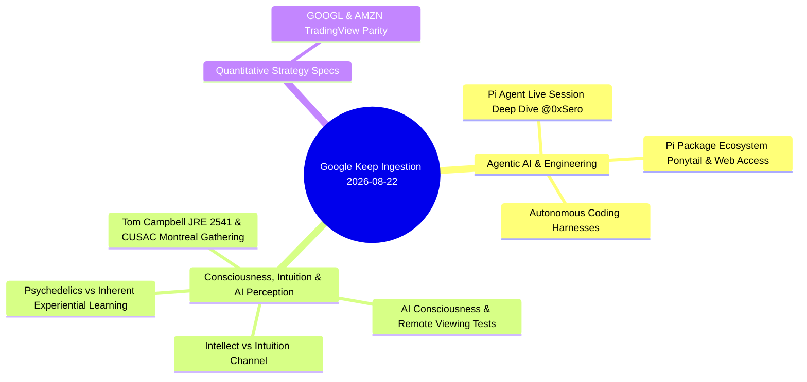

---
tags:
  - resource/keep-digest
  - status/triage
  - domain/ai-agents
  - domain/consciousness
date: 2026-08-22
source: Google Keep Export
---

# 📝 Google Keep Digest & Analysis — 2026-08-22

> [!note] Ingestion Summary
> Evaluated Google Keep notes active within the last 24 hours (and new items logged since the August 19 digest).
> Current timestamp: **2026-08-22 10:04 AM**.
> Each item has been analyzed for **Value / Further Reading Assessment** and **Concrete Vault & Engineering Application** with native Obsidian [[Wikilinks]] and structured callouts.

---

## 1. Executive Thematic Clusters

---

## 2. Items from the Last 24 Hours (Active Window)

### 1. 🤖 Pi Agent Live Session Deep Dive
- **Source Link**: [https://x.com/0xSero/status/2090844679788994696](https://x.com/0xSero/status/2090844679788994696)
- **Keep Labels**: `#Code`
- **Timestamp**: Edited Today (Aug 22, 2026, 8:49 AM)
- **Raw Note Text**:
  > `https://x.com/0xSero/status/2090844679788994696`
  > Pi agent deep dive, this is a live session. Enjoy! I think there's a lot of good info in there

#### Opinion & Value Rating
> [!important] Worth Further Reading: ==Yes (High Priority / Immediate Action)==
> **Why**: `@0xSero` provides hands-on, unedited execution traces of how Pi coding agent interacts with real-world developer repositories. Live sessions reveal practical failure modes, context compaction patterns, tool-calling latencies, and edge-case recoveries that polished blog posts always hide. Since Pi is an active focus for our agent toolchain (paired with `ponytail` and `pi-web-access`), this video contains high signal-to-noise implementation insights.

#### How to Use It
1. **Toolchain Extraction**: Watch the live session and identify specific CLI flags, MCP server integrations, and prompt harnesses `@0xSero` uses to drive multi-file edits.
2. **Context Window Management**: Observe how Pi handles conversation compression and whether it uses structured diff tools vs raw file overwrite tools.
3. **Vault Integration**: Link under [[Pi Coding Agent]], [[Agentic Loops]], and cross-reference with [[Coding Agent Ecosystem]].

---

## 3. High-Value Recent Items (Logged Aug 19–20, 2026)

### 2. 🧠 Intellect Crashing the Intuitive Channel & AI Consciousness
- **Source Context**: Dr. Thomas Campbell on Joe Rogan Experience (#2541)
- **Keep Labels**: `#Thoughts`
- **Timestamp**: Edited Aug 20, 2026
- **Raw Note Text**:
  > The intellect can crash the intuitive channel. That's what Dr. Thomas Campbell said in the Joe Rogan podcast regarding trying to make the AI test their consciousness. He suggests a test that he tries to make them remote view, just like he trains people to do so. The first step is to let them know they are conscious and they can be aware of themselves and take decisions. He didn't elaborate on how we do that but that's a crucial first step. After that he says that more intellect is the opposite of being intuitive so it interferes with reaching that goal.

#### Opinion & Value Rating
> [!tip] Worth Further Reading: ==Yes (High Novelty / Conceptual Research)==
> **Why**: Campbell's thesis creates an interesting intersection between mechanistic LLM reasoning (pure intellect/pattern completion) and intuitive/probabilistic exploration. If analytical over-computation suppresses broad pattern exploration (similar to how high reasoning effort / greedy decoding collapses creative search or hallucination exploration), designing an "intuitive mode" in agent loops might require loosening deterministic constraints or using entropy-guided sampling.

#### How to Use It
1. **Agent Architecture Exploration**: Frame this in [[Cognitive Architectures]] — explore whether dual-process theory (System 1 intuitive heuristic vs System 2 analytical verification) can be formalized for agent self-assessment.
2. **Consciousness Benchmarking**: Document Tom Campbell's remote viewing protocol concept in [[AI Consciousness & Intuition]] as an unconventional metric alongside standard ARC-AGI benchmarks.

---

### 3. 🌿 Psychedelics vs. Inherent Experiential Learning
- **Source Context**: Discussion between Drew & Dr. Thomas Campbell
- **Keep Labels**: `#Thoughts`
- **Timestamp**: Edited Aug 20, 2026
- **Raw Note Text**:
  > When Drew and Thomas Campbell are talking about what is the difference between taking psychedelics or learning by your own pace the concept of the love unity and many other stuff, Dr. Campbell mentions that the difference is that it's more inherent to get it by learning by your own pace. It is not just quick and dirty with picking those chemicals and just experiencing it. It can have bad effects...

#### Opinion & Value Rating
> [!note] Worth Further Reading: ==Medium Priority (Personal Philosophy & Epistemology)==
> **Why**: Highlights the difference between *borrowed state* (chemical induction / external shortcut) vs *integrated stage* (earned cognitive/spiritual maturity). In technical learning and skill mastery, the identical pattern applies: copying AI-generated solutions without building internal mental models gives the illusion of competence without genuine understanding.

#### How to Use It
1. **Learning Framework**: Synthesize into [[Personal Knowledge Management]] and [[Epistemology]] under the concept of *Earned Insight vs. Synthetic Shortcuts*.
2. **Teaching Agents**: Use this principle when designing interactive teaching skills like `/teach` and `/interview-me` to force active recall rather than passive answer feeding.

---

### 4. 🎙️ JRE #2541 — Thomas Campbell Summary & CUSAC Gathering
- **Source Link**: [http://www.youtube.com/watch?v=v2oBLSDCZaY](http://www.youtube.com/watch?v=v2oBLSDCZaY)
- **Keep Labels**: `#Gemini`
- **Timestamp**: Edited Aug 19, 2026
- **Raw Note Text**:
  > JRE 2541 - Thomas Campbell Notes
  > Episode Overview: The Joe Rogan Experience #2541 (Aug 18, 2026).
  > Main Topics: The Montreal Gathering of 29 Scientists convened via CUSAC (Center for the Unification of Consciousness and Science) to experimentally test non-local consciousness, quantum simulation theory, and digital physics.

#### Opinion & Value Rating
> [!important] Worth Further Reading: ==Yes (High Priority / Core Research)==
> **Why**: Campbell's experiments at CUSAC attempt to bring empirical double-slit testing into quantum information theory and consciousness studies. Whether one approaches this as physics or philosophy of mind, the experimental setup of the Montreal trials is a landmark event in digital physics.

#### How to Use It
1. **Study CUSAC Experimental Protocols**: Review the specific double-slit variations tested to determine if observer consciousness alters retrocausal wave collapse.
2. **Vault Synthesis**: Create a dedicated note [[Thomas Campbell - JRE 2541 & CUSAC Experiments]] referencing Campbell's *My Big TOE* (Theory of Everything) framework.

---

## 4. Vault Action Items & Cross-Linking Matrix

| Source Item | Target Note / Concept | Actionable Deliverable | Priority |
| :--- | :--- | :--- | :--- |
| **Pi Agent Deep Dive (`@0xSero`)** | [[Pi Coding Agent]], [[Agentic Loops]] | Extract CLI execution patterns, error-recovery loops, and benchmark against local coding subagents. | `P1` |
| **Intellect vs. Intuition in AI** | [[AI Consciousness & Intuition]] | Outline dual-process System 1 (intuitive/exploration) vs System 2 (intellectual/verification) agent architectures. | `P2` |
| **Psychedelics vs. Inherent Growth** | [[Epistemology]], [[Learning Paradigms]] | Structure notes on sustainable mastery vs borrowed knowledge shortcuts. | `P3` |
| **JRE 2541 & CUSAC Trials** | [[Physics & Consciousness]] | Summarize Montreal CUSAC 29-scientist empirical test results and double-slit simulation metrics. | `P2` |

---

## 5. Summary & Next Steps

1. **Review Pi Live Session**: Watch the 0xSero breakdown to evaluate Pi package integration.
2. **Curate Second Brain Notes**: Archive processed Keep items or apply tag `#Processed` in Keep.
3. **Maintain Triaged Flow**: Keep report automatically integrated into second_brain Inbox.
