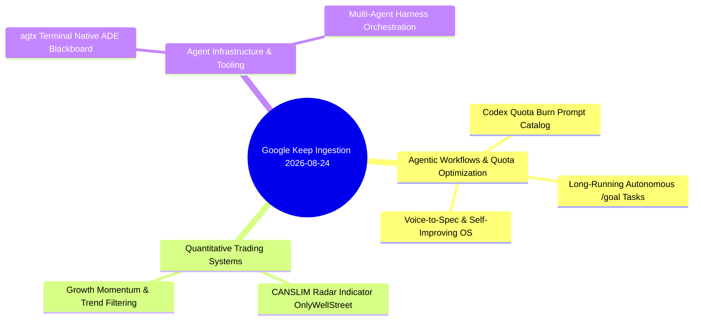

---
tags:
  - resource/keep-digest
  - status/triage
  - domain/ai-agents
  - domain/trading
  - domain/developer-tools
date: 2026-08-24
source: Google Keep Export
---

# 📝 Google Keep Digest & Analysis — 2026-08-24

> [!note] Ingestion Summary
> Evaluated Google Keep notes active within the last 24 hours (August 23, 2026 10:00 AM – August 24, 2026 10:02 AM).
> Current timestamp: **2026-08-24 10:02 AM**.
> Each item has been analyzed for **Value / Further Reading Assessment** and **Concrete Vault & Engineering Application** with native Obsidian [[Wikilinks]] and structured callouts.

---

## 1. Executive Thematic Clusters

---

## 2. Items from the Last 24 Hours (Active Window)

### 1. ⚡ Codex Quota Burn & Autonomous `/goal` Prompts Catalog
- **Source Context**: Tactical prompt collection for exhausting Codex/Sol subscription quota before 6-hour reset window
- **Keep Labels**: None (Unlabeled)
- **Timestamp**: Edited Today (Aug 24, 2026, 6:45 AM)
- **Raw Note Text**:
  > `Codex limits will RESET in ~6 hours. Burn all your quota with ☀️Sol. Ideas below`
  > - `/goal analyze every project in my workspace. Identify abandoned, duplicated, or unfinished work. Create a prioritized cleanup plan and safely complete the obvious items.`
  > - `/goal audit my monthly spending and subscriptions. Find waste, suggest better options, and make a savings plan.`
  > - `/goal improve this app’s performance. Establish benchmarks, locate bottlenecks, make measured improvements, and report before-and-after results.`
  > - `/goal audit my computer files and look for opportunities for better organization. Take care of the obvious ones. Consult me for more important ones. Leave no stone unturned`
  > - `(inside one of your projects) /goal create exit/entry animations for anything that can have it. Smooth. Look for other opportunities. Improve UI, be minimalistic and make this attractive to look at and easy to immediately visually parse.`
  > - `audit my skills and actions inside of codex and look for optimizations that I should have and execute them`
  > - `Yap into the mic for 5 minutes about a beautiful world that you want to explore. /imagegen 5 inspo images of it to confirm the look and feel. -> /goal "build a game that looks exactly like the world in these inspo images. Do not stop building until it is utterly perfect."`
  > - `/goal build a personal knowledge system from my files, notes, and projects. Organize everything so I can quickly find and use it.`
  > - `/goal build my personal AI operating system. Automate recurring work, create reusable tools, and organize everything in one dashboard`
  > - `Audit my life, ask me questions, design a perfect schedule for my life that will fill me with energy every day. Include sleep, nutrition, exercise, socializing, creative fulfillment, and career advancement.`
  > - `/goal generate 100 product ideas from my skills and interests. Score them for demand, difficulty, differentiation, startup cost, and time to first revenue.`
  > - `/goal Teach me (X) skill. Research the best and most fun ways to learn the skill step-by-step. Create a full learning course for me complete with videos, podcasts, readings, and a schedule that I can fully interact with and check off as I complete them.`

#### Opinion & Value Rating
> [!important] Worth Further Reading / Implementation: ==Yes (High Priority / Immediate Utility — 9.5/10)==
> **Why**: This note formalizes high-leverage asynchronous `/goal` patterns. The core paradigm shift is treating LLM quota as a perishable asset and dispatching end-to-end background autonomous agents to do deep audits (workspace cleanup, personal OS building, life scheduling, performance benchmarking) rather than letting quota expire unused.

#### How to Use It
1. **Quota-Reset Automations**: Create a quick cron / trigger script or checklist to fire off 1–2 of these prompts whenever quota reset is approaching.
2. **Project Hygiene Audits**: Immediately execute prompt #1 (`/goal analyze every project in my workspace...`) on legacy directories in `Code/` to identify dead code, duplicate scratch files, and uncommitted branches.
3. **Curriculum & Skill Generation**: Use the `/goal Teach me (X) skill` harness for onboarding into new domain topics (e.g. advanced PineScript, Markov Chains, or WebGL).
4. **Vault Integration**: Save and cross-link under [[AgenticLoops]], [[AiDevTasks]], [[ClaudeCode]], and [[MasteringProductivity]].

---

### 2. 📈 CANSLIM Radar — TradingView Indicator by OnlyWellStreet
- **Source Link**: [https://il.tradingview.com/script/IlPWFfCB/](https://il.tradingview.com/script/IlPWFfCB/)
- **Keep Labels**: `#Tradings`
- **Timestamp**: Edited Today (Aug 24, 2026, 6:13 AM)
- **Raw Note Text**:
  > `https://il.tradingview.com/script/IlPWFfCB/`
  > `CANSLIM Radar — אינדיקטור מאת OnlyWellStreet (il.tradingview.com)`

#### Opinion & Value Rating
> [!tip] Worth Further Reading: ==Yes (Medium-High Priority / Strategy Component — 8/10)==
> **Why**: CANSLIM (William J. O'Neil) is one of the most proven quantitative/fundamental momentum methodologies for equities, blending fundamental growth (Current/Annual earnings) with technical price momentum (New highs, Supply/demand volume spikes, Market direction). An on-chart TradingView radar script consolidates multi-factor scanning into an immediate visual readout.

#### How to Use It
1. **PineScript Code Inspection**: Load the script in TradingView, inspect the open-source PineScript indicators used (Relative Strength vs benchmark, Volume surge threshold, Pivot breakout calculations).
2. **Signal Export & Backtesting**: Extract the technical screening rules (e.g., RS > 80, Breakout from base, Volume > 150% 50-day SMA) into Python/Jesse or PineScript strategy tester to measure statistical edge and win rate across US tech equities (e.g., GOOGL, NVDA, AMZN).
3. **Vault Integration**: Link under [[AlgorithmicTrading]], [[FinancialTechnicalAnalysis]], [[MomentumTrading]], and cross-reference with [[The Math of Winning in Trading]].

---

### 3. 🖥️ `agtx` — The Blackboard for Coding Agents (Terminal-Native ADE)
- **Source Link**: [https://github.com/fynnfluegge/agtx](https://github.com/fynnfluegge/agtx)
- **Keep Labels**: `#Code`
- **Timestamp**: Edited Yesterday (Aug 23, 2026, 11:08 PM)
- **Raw Note Text**:
  > `https://github.com/fynnfluegge/agtx`
  > `GitHub - fynnfluegge/agtx: The blackboard for coding agents. Terminal-native ADE for claude code, codex, cursor, opencode, grok and more`

#### Opinion & Value Rating
> [!important] Worth Further Reading: ==Yes (High Priority / Core Infrastructure — 9/10)==
> **Why**: As development transitions from single chat assistants to heterogeneous multi-agent systems (Claude Code, Codex CLI, Antigravity, Cursor, Grok), developers suffer from fragmented context and disconnected terminal sessions. `agtx` implements a shared **Blackboard Architecture** in a terminal-native ADE (Agent Development Environment), allowing multiple autonomous agents to share memory, observe peer progress, and avoid duplication.

#### How to Use It
1. **Architecture Study**: Clone `fynnfluegge/agtx` and analyze its IPC / shared blackboard synchronization engine.
2. **Terminal Workflow Integration**: Evaluate `agtx` as a terminal multiplexer and supervisor layer when running parallel CLI agents.
3. **Vault Integration**: Document the blackboard architectural pattern in [[AgentTeams]], [[AgenticBestPractices]], [[LLMOrchestration]], and [[ClaudeCode]].

---

## 3. Vault Action Items & Cross-Linking Matrix

| Source Item | Target Note / Concept | Actionable Deliverable | Priority |
| :--- | :--- | :--- | :--- |
| **Codex Quota Burn Catalog** | [[AgenticLoops]], [[MasteringProductivity]] | Integrate high-leverage `/goal` prompts into standard workflow routines and automated cleanup scripts. | `P1` |
| **CANSLIM Radar (`OnlyWellStreet`)** | [[AlgorithmicTrading]], [[MomentumTrading]] | Review PineScript logic on TradingView; translate entry/exit rules into quantitative backtesting harness. | `P2` |
| **`agtx` Terminal ADE Blackboard** | [[AgentTeams]], [[LLMOrchestration]] | Review GitHub repo for multi-agent state sharing and terminal coordination patterns. | `P1` |

---

## 4. Summary & Next Steps

1. **Test Quota-Burn Prompts**: Schedule workspace cleanup and file organization `/goal` runs during low-usage hours.
2. **Analyze `agtx` Architecture**: Check repository structure to see how multi-agent blackboards are coordinated across terminal environments.
3. **Evaluate CANSLIM Indicator**: Add CANSLIM Radar to TradingView watchlist and review PineScript code quality.
